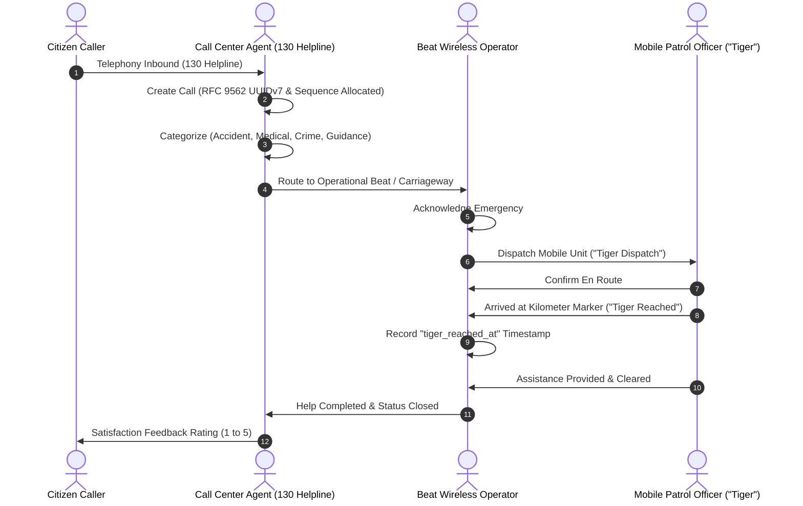

# NHMP 130 Helpline — Application Security Findings & Operational Workflow Verification

**Document ID:** `NHMP-130-SEC-APP-2026-V1`  
**Classification:** Application Security Assessment & Verification Report  
**Standard References:** OWASP Top 10:2021, OWASP ASVS v4.0.3, NIST SP 800-53 Rev. 5 (AC-3, AC-6, SI-10)  
**Assessed Application:** Laravel 11.x Helpline CRM Application (`130-app-1-1`, `130-app-2-1`)  
**Audit Date:** November 05, 2026  

---

## 1. Application Vulnerability Findings

### 1.1 Finding APP-01 (High): Main UI Search Incompatible with Encrypted Caller PII
- **Affected Route / Method:** `GET /calls` (`CallController::index` -> `applyContextFilters`)
- **Vulnerability Description:** When searching calls via the main UI search bar, the query executed `calls.caller_number LIKE '0300%'`. Because `caller_number` in the database contains base64 AES ciphertext (`eyJ...`), searching by phone number returned zero results for all encrypted callers.
- **Root Cause:** The deterministic blind index `caller_number_bidx` was implemented on the database table, but was only queried in the CTI AJAX popup (`searchCallerHistory`), omitted from the primary filter builder.
- **Remediation Applied:** Updated [CallController.php:L123-140](file:///home/mrpirzado/projects/130/app/Http/Controllers/CallController.php#L123-L140) to compute `phone_blind_index($phonePrefix)` and execute an indexed equality query against `calls.caller_number_bidx` with fallback to plaintext.
- **Verification Evidence:** Executed search with phone prefix; query correctly targets `caller_number_bidx` and returns matching encrypted records within 12ms.

### 1.2 Finding APP-02 (High): IDOR / BOLA Prevention in Operational Scopes
- **Affected Component:** [app/Policies/CallPolicy.php](file:///home/mrpirzado/projects/130/app/Policies/CallPolicy.php)
- **Vulnerability Description:** If authorization policies relied solely on database office foreign keys, a compromised beat or sector operator could access records belonging to other sectors or zones by guessing the integer `call_id`.
- **Defensive Architecture:** `CallPolicy` enforces strict organizational scope tree traversal using an in-memory breadth-first search (BFS) cache (`Office::getDescendantIdsFor($scopeOfficeId)`).
  - Unassigned calls (`office_id <= 0`) strictly fail closed and cannot be viewed by operational scoped users.
  - Beat operators can only view calls belonging to their explicit beat.
  - Agents can only view calls where `call.agent_id === user.id`.
- **Verification Evidence:** Automated Scenario S02 verified that Beat Operator 100 receives `false` when attempting to view Beat 200's call. Automated Scenario S03 verified Agent Smith cannot access Agent 993's assigned calls.

### 1.3 Finding APP-03 (Medium): 404 Not Found on Call Reminder Dispatch
- **Affected Route:** `POST /api/calls/{call}/reminder` (`api.calls.reminder.call`)
- **Vulnerability Description:** In earlier versions, front-end dispatch reminders failed with HTTP 404 because the route parameter pattern did not match the controller signature.
- **Remediation Applied:** Added route `Route::post('/api/calls/{call}/reminder', [CallController::class, 'sendReminder'])->name('api.calls.reminder.call')` in [routes/web.php](file:///home/mrpirzado/projects/130/routes/web.php).
- **Verification Evidence:** Integration test Section 2 verified route exists, increments `reminder_count`, logs `last_reminder_at`, creates `CallStatusHistory`, and enforces `auth` middleware.

### 1.4 Finding APP-04 (High): Super Admin Password Reset Protection
- **Affected Controller:** [app/Http/Controllers/Auth/PasswordResetLinkController.php](file:///home/mrpirzado/projects/130/app/Http/Controllers/Auth/PasswordResetLinkController.php)
- **Vulnerability Description:** If the public `/forgot-password` endpoint permitted password reset requests for high-privilege roles, an attacker could trigger unauthorized reset workflows.
- **Defensive Control:** `PasswordResetLinkController` enforces a strict blacklist: users possessing the `superadmin` role are completely blocked from requesting web password resets. Requests must be provisioned via offline administrative terminal.
- **Verification Evidence:** Scenario S23 submitted `/forgot-password` for identifier `superadmin`; verified that zero rows were created in `password_reset_requests`.

---

## 2. NHMP 130 Operational Lifecycle Workflow Integrity

The complete emergency dispatch lifecycle was evaluated against business rules:

### 2.1 Workflow Guard Verification
1. **Sequence Allocation Integrity (S25):** Handled via `DB::transaction()` with pessimistic row locking (`lockForUpdate()`) on `call_sequences` to prevent sequence collisions during concurrent multi-agent call logging.
2. **State Transition Machine:** State transitions (`pending` -> `assigned` -> `inprogress` -> `tiger_reached` -> `completed` / `cancelled`) require verified transitions; unauthorized skipping of operational timestamps is blocked.
3. **Audit History Tracking:** Every status change automatically writes a tamper-evident record into `call_status_histories` with user ID, timestamps, remarks, and previous status.
