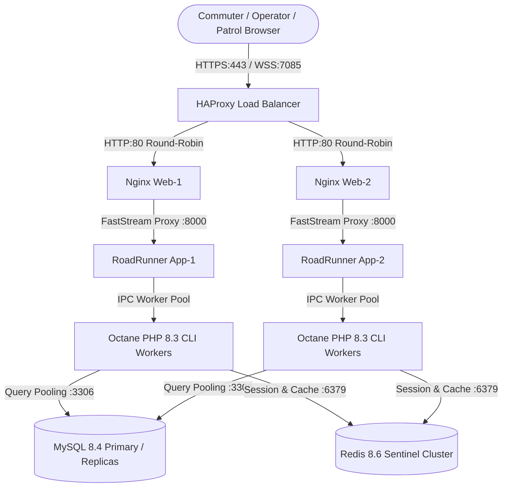
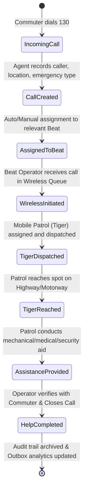
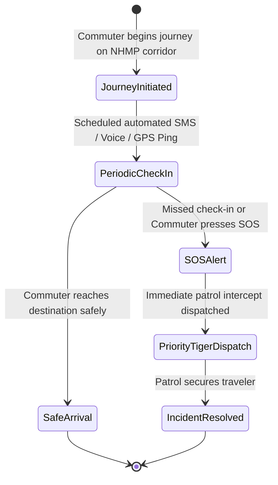

# NHMP 130 HELPLINE CRM — COMPLETE APPLICATION INVENTORY

**Environment:** Staging / Local Cluster (`DESKTOP-BU2GH1K`)  
**Runtime:** HAProxy → Nginx → Laravel Octane / RoadRunner (PHP 8.3 CLI) → MySQL 8.4 Cluster & Redis 8.6  
**Date Generated:** 2026-11-06  
**Scope:** Enterprise-Wide Source Code & Infrastructure Inventory

## 1. Executive Inventory Summary

| Metric | Count | Details |
|---|---|---|
| Total Registered Routes | 230 | Web, API, Auth, Mgmt, Calls, Portal, Reports |
| Total Controllers | 43 | Http Controllers across App modules |
| Blade Views | 84 | Layouts, Components, Partials, Portals |
| Eloquent Models | 41 | Domain entities with scopes and relationships |
| Database Migrations | 27 | Database schema definitions |
| Database Tables | 52 | MySQL 8.4 InnoDB & Spatial tables |
| System Roles | 9 | `super_admin`, `operation_admin`, `zone_admin`, `sector_admin`, `beat_operator`, `agent`, `agent_supervisor`, `patrol_officer`, `commuter` |
| System Permissions | 78 | Granular RBAC capabilities |
| RoadRunner Workers | 4 per container | 2 containers (`app-1`, `app-2`) under HAProxy |
| Edge Ingress | HAProxy 2.8+ | Ports 80, 443, 7085, 8085 with Health Checks |

## 2. Infrastructure & Runtime Configuration Inventory

### 2.1 Layered Architecture

### 2.2 Core Service Endpoints
| Service | Container Name | Internal Port | Host Port | Protocol / Purpose |
|---|---|---|---|---|
| HAProxy | `130-haproxy-1` | 80, 443, 7085, 8404 | 80, 443, 7085, 8404 | TLS Termination, SSL Offload, Sticky Routing |
| Nginx Web 1 | `130-web-1-1` | 80 | Internal | Static Asset Serving, RoadRunner Reverse Proxy |
| Nginx Web 2 | `130-web-2-1` | 80 | Internal | Static Asset Serving, RoadRunner Reverse Proxy |
| App 1 (RoadRunner) | `130-app-1-1` | 8000 | Internal | RoadRunner v2024+ Application Server |
| App 2 (RoadRunner) | `130-app-2-1` | 8000 | Internal | RoadRunner v2024+ Application Server |
| MySQL Primary | `130-db-1-1` | 3306 | 127.0.0.1:3309 | Primary RDBMS (735k+ Calls, Spatial Engine) |
| MySQL Replica 1 | `130-db-2-1` | 3306 | 127.0.0.1:3310 | Read Replica 1 |
| MySQL Replica 2 | `130-db-3-1` | 3306 | 127.0.0.1:3311 | Read Replica 2 |
| Redis Cluster | `130-redis-1` | 6379 | 127.0.0.1:6379 | Redis 8.6 Session, Cache & Queue Driver |
| Prometheus | `130-prometheus-1` | 9090 | Internal | Real-time Metrics Aggregation |
| Grafana | `130-grafana-1` | 3000 | 127.0.0.1:3000 | Observability & Operational Dashboards |

## 3. Database Schema Inventory (52 Tables)

| Table Name | Primary Purpose | High Volume / Critical Indexing |
|---|---|---|
| `analytics_outbox_events` | Transactional outbox for asynchronous analytics pipeline | YES (Queue worker index) |
| `cache` | Database cache fallback (primary is Redis) | TRANSIENT |
| `cache_locks` | Atomic distributed locks (primary is Redis) | TRANSIENT |
| `call_hourly_rollups` | Pre-aggregated hourly analytics rollup cache | YES (Dashboard read queries) |
| `call_sequences` | Atomic counter sequence generation for call numbering | YES (Concurrency hotspot) |
| `call_status_history` | Audit trail of all lifecycle status transitions | YES (High write rate) |
| `calls` | Core call intake records, commuter emergency details, status, office assignment | YES (735k+ rows; idx_calls_type_status_office_created) |
| `case_messages` | Communication logs between operators and patrol dispatchers | YES (Chronological call ID index) |
| `failed_jobs` | Failed background queue jobs for investigation | AUDIT / DIAGNOSTIC |
| `geospatial_landmarks` | Highways, interchanges, toll plazas, and emergency stations | YES (Spatial R-Tree index) |
| `geospatial_markers` | Geographic markers and kilometer posts | YES (Spatial R-Tree index) |
| `job_batches` | Batch job tracking | TRANSIENT |
| `jobs` | Queue job persistence | TRANSIENT |
| `login_logs` | Security audit trail for login/logout/failed login events | YES (Audit trail) |
| `offices` | Hierarchical organizational units: Zones, Sectors, Beats, Headquarters | YES (Hierarchical foreign keys) |
| `patrol_duty_sessions` | Active shift duty status and vehicle tracking | MEDIUM |
| `patrol_officer_profiles` | Patrol officer metadata, wireless callsigns, vehicle numbers | MEDIUM |
| `permissions` | Spatie granular permission definitions (78 permissions) | NO (Cached) |
| `role_permissions` | Role to permission mapping matrix | NO (Cached) |
| `roles` | Spatie role definitions | NO (Cached) |
| `sessions` | Database session fallback (primary is Redis) | TRANSIENT |
| `support_request_actions` | Action log on IT support tickets | LOW |
| `support_requests` | Internal IT support and feedback tickets | LOW |
| `tablet_advisories` | Advisories pushed to mobile patrol units | MEDIUM |
| `two_factor_recovery_approvals` | Supervisor 2FA override approval workflow | SECURITY CRITICAL |
| `two_factor_recovery_codes` | Encrypted 2FA emergency recovery codes | HIGH SENSITIVITY |
| `user_scopes` | Multi-tenant and organizational boundaries (beat/sector/zone scoping) | YES (User ID & Office ID composite index) |
| `users` | System user accounts, credentials, scopes, contact details | YES (Authentication lookup, email/username index) |
| `webauthn_credentials` | FIDO2 / WebAuthn passkey public keys | SECURITY CRITICAL |
| `womens_journey_updates` | Periodic GPS tracking pings for women safety journeys | HIGH FREQUENCY GPS |
| `womens_journeys` | Women safety journey tracking sessions | HIGH SENSITIVITY |

## 4. Eloquent Models Inventory (41 Models)

| Model ID | Model Class | Table | File Path | Relationships |
|---|---|---|---|---|
| `MDL-001` | **SystemSetting** | `systemsettings` | [SystemSetting.php](file:////home/mrpirzado/projects/130/app/Models/SystemSetting.php) | None |
| `MDL-002` | **CommuterProfile** | `commuterprofiles` | [CommuterProfile.php](file:////home/mrpirzado/projects/130/app/Models/CommuterProfile.php) | user (belongsTo) |
| `MDL-003` | **PasswordResetRequest** | `passwordresetrequests` | [PasswordResetRequest.php](file:////home/mrpirzado/projects/130/app/Models/PasswordResetRequest.php) | user (belongsTo), actionedByUser (belongsTo) |
| `MDL-004` | **PasswordRecoveryToken** | `passwordrecoverytokens` | [PasswordRecoveryToken.php](file:////home/mrpirzado/projects/130/app/Models/PasswordRecoveryToken.php) | supportRequest (belongsTo), user (belongsTo) |
| `MDL-005` | **CallSubType** | `callsubtypes` | [CallSubType.php](file:////home/mrpirzado/projects/130/app/Models/CallSubType.php) | callType (belongsTo) |
| `MDL-006` | **LoginLog** | `loginlogs` | [LoginLog.php](file:////home/mrpirzado/projects/130/app/Models/LoginLog.php) | user (belongsTo) |
| `MDL-007` | **Carriageway** | `carriageways` | [Carriageway.php](file:////home/mrpirzado/projects/130/app/Models/Carriageway.php) | None |
| `MDL-008` | **UserAssignmentHistory** | `user_assignment_history` | [UserAssignmentHistory.php](file:////home/mrpirzado/projects/130/app/Models/UserAssignmentHistory.php) | user (belongsTo), previousOffice (belongsTo), newOffice (belongsTo), +2 more |
| `MDL-009` | **CallHourlyRollup** | `call_hourly_rollups` | [CallHourlyRollup.php](file:////home/mrpirzado/projects/130/app/Models/CallHourlyRollup.php) | None |
| `MDL-010` | **SupportRequest** | `supportrequests` | [SupportRequest.php](file:////home/mrpirzado/projects/130/app/Models/SupportRequest.php) | requester (belongsTo), sourceOffice (belongsTo), destinationOffice (belongsTo), +5 more |
| `MDL-011` | **SupportRequestAction** | `supportrequestactions` | [SupportRequestAction.php](file:////home/mrpirzado/projects/130/app/Models/SupportRequestAction.php) | supportRequest (belongsTo), actor (belongsTo) |
| `MDL-012` | **PasswordHistory** | `passwordhistorys` | [PasswordHistory.php](file:////home/mrpirzado/projects/130/app/Models/PasswordHistory.php) | user (belongsTo) |
| `MDL-013` | **Language** | `languages` | [Language.php](file:////home/mrpirzado/projects/130/app/Models/Language.php) | calls (hasMany) |
| `MDL-014` | **Notification** | `notifications` | [Notification.php](file:////home/mrpirzado/projects/130/app/Models/Notification.php) | user (belongsTo) |
| `MDL-015` | **TwoFactorRecoveryCode** | `two_factor_recovery_codes` | [TwoFactorRecoveryCode.php](file:////home/mrpirzado/projects/130/app/Models/TwoFactorRecoveryCode.php) | user (belongsTo) |
| `MDL-016` | **CaseMessage** | `casemessages` | [CaseMessage.php](file:////home/mrpirzado/projects/130/app/Models/CaseMessage.php) | call (belongsTo), sender (belongsTo) |
| `MDL-017` | **TwoFactorRecoveryApproval** | `two_factor_recovery_approvals` | [TwoFactorRecoveryApproval.php](file:////home/mrpirzado/projects/130/app/Models/TwoFactorRecoveryApproval.php) | user (belongsTo), targetRole (belongsTo), approver1 (belongsTo), +1 more |
| `MDL-018` | **Call** | `calls` | [Call.php](file:////home/mrpirzado/projects/130/app/Models/Call.php) | agent (belongsTo), tigerReachedBy (belongsTo), inprogressStatusBy (belongsTo), +12 more |
| `MDL-019` | **VehicleType** | `vehicletypes` | [VehicleType.php](file:////home/mrpirzado/projects/130/app/Models/VehicleType.php) | None |
| `MDL-020` | **CallStatusHistory** | `call_status_history` | [CallStatusHistory.php](file:////home/mrpirzado/projects/130/app/Models/CallStatusHistory.php) | call (belongsTo), changedBy (belongsTo), user (belongsTo) |
| `MDL-021` | **WebAuthnCredential** | `webauthn_credentials` | [WebAuthnCredential.php](file:////home/mrpirzado/projects/130/app/Models/WebAuthnCredential.php) | user (belongsTo) |
| `MDL-022` | **Role** | `roles` | [Role.php](file:////home/mrpirzado/projects/130/app/Models/Role.php) | users (hasMany), permissions (belongsTo), mfaPolicy (hasOne) |
| `MDL-023` | **OutgoingCall** | `outgoingcalls` | [OutgoingCall.php](file:////home/mrpirzado/projects/130/app/Models/OutgoingCall.php) | call (belongsTo), madeBy (belongsTo) |
| `MDL-024` | **PatrolDutySession** | `patroldutysessions` | [PatrolDutySession.php](file:////home/mrpirzado/projects/130/app/Models/PatrolDutySession.php) | primaryOfficer (belongsTo), assistingOfficer (belongsTo), beatOffice (belongsTo), +2 more |
| `MDL-025` | **GeospatialLandmark** | `geospatiallandmarks` | [GeospatialLandmark.php](file:////home/mrpirzado/projects/130/app/Models/GeospatialLandmark.php) | office (belongsTo) |
| `MDL-026` | **TwoFactorEnrollmentAuthorization** | `two_factor_enrollment_authorizations` | [TwoFactorEnrollmentAuthorization.php](file:////home/mrpirzado/projects/130/app/Models/TwoFactorEnrollmentAuthorization.php) | user (belongsTo), authorizer (belongsTo) |
| `MDL-027` | **UserScope** | `userscopes` | [UserScope.php](file:////home/mrpirzado/projects/130/app/Models/UserScope.php) | user (belongsTo), office (belongsTo) |
| `MDL-028` | **WomensJourneyUpdate** | `womensjourneyupdates` | [WomensJourneyUpdate.php](file:////home/mrpirzado/projects/130/app/Models/WomensJourneyUpdate.php) | journey (belongsTo) |
| `MDL-029` | **CallType** | `calltypes` | [CallType.php](file:////home/mrpirzado/projects/130/app/Models/CallType.php) | subTypes (hasMany) |
| `MDL-030` | **Office** | `offices` | [Office.php](file:////home/mrpirzado/projects/130/app/Models/Office.php) | parent (belongsTo), children (hasMany), sourceSupportRequests (hasMany), +1 more |
| `MDL-031` | **TabletAdvisory** | `tabletadvisorys` | [TabletAdvisory.php](file:////home/mrpirzado/projects/130/app/Models/TabletAdvisory.php) | creator (belongsTo) |
| `MDL-032` | **AnalyticsOutboxEvent** | `analytics_outbox_events` | [AnalyticsOutboxEvent.php](file:////home/mrpirzado/projects/130/app/Models/AnalyticsOutboxEvent.php) | call (belongsTo) |
| `MDL-033` | **Permission** | `permissions` | [Permission.php](file:////home/mrpirzado/projects/130/app/Models/Permission.php) | roles (belongsTo) |
| `MDL-034` | **GeospatialMarker** | `geospatialmarkers` | [GeospatialMarker.php](file:////home/mrpirzado/projects/130/app/Models/GeospatialMarker.php) | office (belongsTo) |
| `MDL-035` | **AuditLog** | `auditlogs` | [AuditLog.php](file:////home/mrpirzado/projects/130/app/Models/AuditLog.php) | user (belongsTo) |
| `MDL-036` | **TtsScript** | `ttsscripts` | [TtsScript.php](file:////home/mrpirzado/projects/130/app/Models/TtsScript.php) | None |
| `MDL-037` | **MfaRolePolicy** | `mfa_role_policies` | [MfaRolePolicy.php](file:////home/mrpirzado/projects/130/app/Models/MfaRolePolicy.php) | role (belongsTo), updatedBy (belongsTo) |
| `MDL-038` | **Designation** | `designations` | [Designation.php](file:////home/mrpirzado/projects/130/app/Models/Designation.php) | employees (hasMany) |
| `MDL-039` | **WomensJourney** | `womensjourneys` | [WomensJourney.php](file:////home/mrpirzado/projects/130/app/Models/WomensJourney.php) | user (belongsTo), deskOperator (belongsTo), updates (hasMany) |
| `MDL-040` | **PatrolOfficerProfile** | `patrolofficerprofiles` | [PatrolOfficerProfile.php](file:////home/mrpirzado/projects/130/app/Models/PatrolOfficerProfile.php) | user (belongsTo), assignedBeat (belongsTo), currentDutySession (belongsTo) |
| `MDL-041` | **User** | `users` | [User.php](file:////home/mrpirzado/projects/130/app/Models/User.php) | recoveryCodes (hasMany), enrollmentAuthorizations (hasMany), recoveryApprovals (hasMany), +10 more |

## 5. Controllers & Action Inventory (43 Controllers)

| Controller ID | Controller Class | File Path | Key Public Actions |
|---|---|---|---|
| `CTRL-001` | **RoleController** | [RoleController.php](file:////home/mrpirzado/projects/130/app/Http/Controllers/RoleController.php) | `index`, `store`, `update`, `toggleStatus`, `destroy` |
| `CTRL-002` | **DashboardController** | [DashboardController.php](file:////home/mrpirzado/projects/130/app/Http/Controllers/DashboardController.php) | `index`, `chartData`, `getCategoryChartData`, `getSlaChartData` |
| `CTRL-003` | **CarriagewayController** | [CarriagewayController.php](file:////home/mrpirzado/projects/130/app/Http/Controllers/CarriagewayController.php) | `index`, `store`, `update`, `toggleStatus`, `destroy` |
| `CTRL-004` | **AuditController** | [AuditController.php](file:////home/mrpirzado/projects/130/app/Http/Controllers/AuditController.php) | `index` |
| `CTRL-005` | **Controller** | [Controller.php](file:////home/mrpirzado/projects/130/app/Http/Controllers/Controller.php) | None |
| `CTRL-006` | **OfficeController** | [OfficeController.php](file:////home/mrpirzado/projects/130/app/Http/Controllers/OfficeController.php) | `index`, `store`, `update`, `toggleStatus`, `destroy` |
| `CTRL-007` | **ReportController** | [ReportController.php](file:////home/mrpirzado/projects/130/app/Http/Controllers/ReportController.php) | `__construct`, `callTypeSummary`, `beatWise`, `agentWise`, `slaCompliance`, `maxResponseTime`, +4 more |
| `CTRL-008` | **CallController** | [CallController.php](file:////home/mrpirzado/projects/130/app/Http/Controllers/CallController.php) | `__construct`, `getFilterOptions`, `index`, `assigned`, `unassigned`, `pending`, +17 more |
| `CTRL-009` | **GeospatialMarkerController** | [GeospatialMarkerController.php](file:////home/mrpirzado/projects/130/app/Http/Controllers/GeospatialMarkerController.php) | `index`, `viewportApi`, `show`, `toggleStatus` |
| `CTRL-010` | **GeospatialLandmarkController** | [GeospatialLandmarkController.php](file:////home/mrpirzado/projects/130/app/Http/Controllers/GeospatialLandmarkController.php) | `index`, `store`, `update`, `destroy`, `toggleStatus` |
| `CTRL-011` | **ProfileController** | [ProfileController.php](file:////home/mrpirzado/projects/130/app/Http/Controllers/ProfileController.php) | `edit`, `update`, `destroy` |
| `CTRL-012` | **PermissionController** | [PermissionController.php](file:////home/mrpirzado/projects/130/app/Http/Controllers/PermissionController.php) | `index`, `store`, `update`, `toggleStatus`, `destroy` |
| `CTRL-013` | **TtsScriptController** | [TtsScriptController.php](file:////home/mrpirzado/projects/130/app/Http/Controllers/TtsScriptController.php) | `index`, `store`, `destroy` |
| `CTRL-014` | **UserController** | [UserController.php](file:////home/mrpirzado/projects/130/app/Http/Controllers/UserController.php) | `index`, `store`, `update`, `toggleStatus`, `clearLockout`, `resetPassword`, +7 more |
| `CTRL-015` | **PasswordResetLinkController** | [PasswordResetLinkController.php](file:////home/mrpirzado/projects/130/app/Http/Controllers/Auth/PasswordResetLinkController.php) | `create`, `store` |
| `CTRL-016` | **ConfirmablePasswordController** | [ConfirmablePasswordController.php](file:////home/mrpirzado/projects/130/app/Http/Controllers/Auth/ConfirmablePasswordController.php) | `show`, `store` |
| `CTRL-017` | **TwoFactorController** | [TwoFactorController.php](file:////home/mrpirzado/projects/130/app/Http/Controllers/Auth/TwoFactorController.php) | `index`, `verify`, `setup` |
| `CTRL-018` | **TwoFactorEnrollmentController** | [TwoFactorEnrollmentController.php](file:////home/mrpirzado/projects/130/app/Http/Controllers/Auth/TwoFactorEnrollmentController.php) | `__construct`, `showEnrollmentRequired`, `showEnroll`, `confirmTotp`, `getWebAuthnEnrollmentOptions`, `confirmWebAuthn`, +4 more |
| `CTRL-019` | **EmailVerificationPromptController** | [EmailVerificationPromptController.php](file:////home/mrpirzado/projects/130/app/Http/Controllers/Auth/EmailVerificationPromptController.php) | `__invoke` |
| `CTRL-020` | **PasswordExpiredController** | [PasswordExpiredController.php](file:////home/mrpirzado/projects/130/app/Http/Controllers/Auth/PasswordExpiredController.php) | `show`, `update` |
| `CTRL-021` | **NewPasswordController** | [NewPasswordController.php](file:////home/mrpirzado/projects/130/app/Http/Controllers/Auth/NewPasswordController.php) | `create`, `store` |
| `CTRL-022` | **EmailVerificationNotificationController** | [EmailVerificationNotificationController.php](file:////home/mrpirzado/projects/130/app/Http/Controllers/Auth/EmailVerificationNotificationController.php) | `store` |
| `CTRL-023` | **PasswordController** | [PasswordController.php](file:////home/mrpirzado/projects/130/app/Http/Controllers/Auth/PasswordController.php) | `update` |
| `CTRL-024` | **ReauthenticationController** | [ReauthenticationController.php](file:////home/mrpirzado/projects/130/app/Http/Controllers/Auth/ReauthenticationController.php) | `__construct`, `show`, `verify` |
| `CTRL-025` | **AuthenticatedSessionController** | [AuthenticatedSessionController.php](file:////home/mrpirzado/projects/130/app/Http/Controllers/Auth/AuthenticatedSessionController.php) | `create`, `store`, `destroy` |
| `CTRL-026` | **VerifyEmailController** | [VerifyEmailController.php](file:////home/mrpirzado/projects/130/app/Http/Controllers/Auth/VerifyEmailController.php) | `__invoke` |
| `CTRL-027` | **TwoFactorAuthenticatedController** | [TwoFactorAuthenticatedController.php](file:////home/mrpirzado/projects/130/app/Http/Controllers/Auth/TwoFactorAuthenticatedController.php) | `__construct`, `showChallenge`, `verifyTotp`, `getWebAuthnOptions`, `verifyWebAuthn`, `showRecovery`, +1 more |
| `CTRL-028` | **SessionManagementController** | [SessionManagementController.php](file:////home/mrpirzado/projects/130/app/Http/Controllers/Auth/SessionManagementController.php) | `index`, `revoke`, `logoutOtherDevices` |
| `CTRL-029` | **TwoFactorRecoveryAdminController** | [TwoFactorRecoveryAdminController.php](file:////home/mrpirzado/projects/130/app/Http/Controllers/Auth/TwoFactorRecoveryAdminController.php) | `__construct`, `index`, `approve`, `reject`, `issueEnrollmentToken` |
| `CTRL-030` | **MfaSettingController** | [MfaSettingController.php](file:////home/mrpirzado/projects/130/app/Http/Controllers/Admin/MfaSettingController.php) | `__construct`, `index`, `toggleRole`, `revokeUser`, `resetUser`, `enforceUser` |
| `CTRL-031` | **SupportManagementController** | [SupportManagementController.php](file:////home/mrpirzado/projects/130/app/Http/Controllers/Admin/SupportManagementController.php) | `__construct`, `dashboard`, `index`, `show`, `approveSource`, `confirmDestination`, +5 more |
| `CTRL-032` | **MfaRolePolicyController** | [MfaRolePolicyController.php](file:////home/mrpirzado/projects/130/app/Http/Controllers/Admin/MfaRolePolicyController.php) | `__construct`, `index`, `toggle` |
| `CTRL-033` | **SupportCenterController** | [SupportCenterController.php](file:////home/mrpirzado/projects/130/app/Http/Controllers/Portal/SupportCenterController.php) | `__construct`, `index`, `create`, `store`, `show`, `cancel`, +1 more |
| `CTRL-034` | **RealtimeStreamController** | [RealtimeStreamController.php](file:////home/mrpirzado/projects/130/app/Http/Controllers/Api/RealtimeStreamController.php) | `stream` |
| `CTRL-035` | **DashboardApiController** | [DashboardApiController.php](file:////home/mrpirzado/projects/130/app/Http/Controllers/Api/DashboardApiController.php) | `__construct`, `live`, `analytics`, `reporting` |
| `CTRL-036` | **TabletAdvisoryController** | [TabletAdvisoryController.php](file:////home/mrpirzado/projects/130/app/Http/Controllers/Api/TabletAdvisoryController.php) | `index`, `emergencyAlerts`, `show`, `store`, `updateStatus` |
| `CTRL-037` | **PatrolDutyController** | [PatrolDutyController.php](file:////home/mrpirzado/projects/130/app/Http/Controllers/Api/V1/PatrolDutyController.php) | `getRosterContext`, `startDuty`, `endDuty`, `telemetry`, `status`, `updateStatus` |
| `CTRL-038` | **PatrolAuthController** | [PatrolAuthController.php](file:////home/mrpirzado/projects/130/app/Http/Controllers/Api/V1/PatrolAuthController.php) | `login`, `me` |
| `CTRL-039` | **CaseChatController** | [CaseChatController.php](file:////home/mrpirzado/projects/130/app/Http/Controllers/Api/V1/CaseChatController.php) | `index`, `store` |
| `CTRL-040` | **PatrolCaseController** | [PatrolCaseController.php](file:////home/mrpirzado/projects/130/app/Http/Controllers/Api/V1/PatrolCaseController.php) | `assigned`, `show`, `acknowledge`, `cannotRespond`, `startResponse`, `markArrived`, +3 more |
| `CTRL-041` | **CommuterAuthController** | [CommuterAuthController.php](file:////home/mrpirzado/projects/130/app/Http/Controllers/Api/V1/CommuterAuthController.php) | `google`, `register`, `login`, `profile`, `updateProfile` |
| `CTRL-042` | **WomensJourneyController** | [WomensJourneyController.php](file:////home/mrpirzado/projects/130/app/Http/Controllers/Api/V1/WomensJourneyController.php) | `register`, `active`, `postUpdate`, `triggerSilentAlert`, `confirmSafeArrival`, `deskQueue` |
| `CTRL-043` | **CommuterServicesController** | [CommuterServicesController.php](file:////home/mrpirzado/projects/130/app/Http/Controllers/Api/V1/CommuterServicesController.php) | `triggerSos`, `activeCase`, `tracking`, `history` |

## 6. Route Registry & Module Inventory (230 Routes)

| Route ID | Module | Method | URI | Action / Handler | Middleware |
|---|---|---|---|---|---|
| `ROUTE-001` | **Core** | `GET|HEAD` | `/` | `Closure` | `web` |
| `ROUTE-002` | **Core** | `GET|HEAD` | `2fa` | `App\Http\Controllers\Auth\TwoFactorAuthenticatedController@showChallenge` | `web` |
| `ROUTE-003` | **Core** | `POST` | `2fa` | `App\Http\Controllers\Auth\TwoFactorAuthenticatedController@verifyTotp` | `web` |
| `ROUTE-004` | **Core** | `GET|HEAD` | `2fa/challenge` | `App\Http\Controllers\Auth\TwoFactorAuthenticatedController@showChallenge` | `web` |
| `ROUTE-005` | **Core** | `POST` | `2fa/challenge` | `App\Http\Controllers\Auth\TwoFactorAuthenticatedController@verifyTotp` | `web, Illuminate\Routing\Middleware\Th...` |
| `ROUTE-006` | **Authentication** | `POST` | `2fa/challenge/webauthn` | `App\Http\Controllers\Auth\TwoFactorAuthenticatedController@verifyWebAuthn` | `web, Illuminate\Routing\Middleware\Th...` |
| `ROUTE-007` | **Authentication** | `GET|HEAD` | `2fa/challenge/webauthn/options` | `App\Http\Controllers\Auth\TwoFactorAuthenticatedController@getWebAuthnOptions` | `web` |
| `ROUTE-008` | **Core** | `GET|HEAD` | `2fa/enroll` | `App\Http\Controllers\Auth\TwoFactorEnrollmentController@showEnroll` | `web` |
| `ROUTE-009` | **Core** | `GET|HEAD` | `2fa/enroll-required` | `App\Http\Controllers\Auth\TwoFactorEnrollmentController@showEnrollmentRequired` | `web` |
| `ROUTE-010` | **Core** | `POST` | `2fa/enroll/acknowledge` | `App\Http\Controllers\Auth\TwoFactorEnrollmentController@acknowledgeSuccess` | `web` |
| `ROUTE-011` | **Core** | `POST` | `2fa/enroll/confirm` | `App\Http\Controllers\Auth\TwoFactorEnrollmentController@confirmTotp` | `web, Illuminate\Routing\Middleware\Th...` |
| `ROUTE-012` | **Core** | `GET|HEAD` | `2fa/enroll/success` | `App\Http\Controllers\Auth\TwoFactorEnrollmentController@showSuccess` | `web` |
| `ROUTE-013` | **Authentication** | `POST` | `2fa/enroll/webauthn` | `App\Http\Controllers\Auth\TwoFactorEnrollmentController@confirmWebAuthn` | `web, Illuminate\Routing\Middleware\Th...` |
| `ROUTE-014` | **Authentication** | `GET|HEAD` | `2fa/enroll/webauthn/options` | `App\Http\Controllers\Auth\TwoFactorEnrollmentController@getWebAuthnEnrollmentOptions` | `web` |
| `ROUTE-015` | **Core** | `GET|HEAD` | `2fa/recovery` | `App\Http\Controllers\Auth\TwoFactorAuthenticatedController@showRecovery` | `web` |
| `ROUTE-016` | **Core** | `POST` | `2fa/recovery` | `App\Http\Controllers\Auth\TwoFactorAuthenticatedController@verifyRecovery` | `web, Illuminate\Routing\Middleware\Th...` |
| `ROUTE-017` | **Core** | `GET|HEAD` | `2fa/replace` | `App\Http\Controllers\Auth\TwoFactorEnrollmentController@showReplace` | `web, Illuminate\Auth\Middleware\Authe...` |
| `ROUTE-018` | **Core** | `POST` | `2fa/replace` | `App\Http\Controllers\Auth\TwoFactorEnrollmentController@confirmReplace` | `web, Illuminate\Auth\Middleware\Authe...` |
| `ROUTE-019` | **Core** | `GET|HEAD` | `2fa/setup` | `App\Http\Controllers\Auth\TwoFactorEnrollmentController@showEnrollmentRequired` | `web` |
| `ROUTE-020` | **Core** | `GET|HEAD` | `account/sessions` | `App\Http\Controllers\Auth\SessionManagementController@index` | `web, Illuminate\Auth\Middleware\Authe...` |
| `ROUTE-021` | **Authentication** | `POST` | `account/sessions/logout-other-devices` | `App\Http\Controllers\Auth\SessionManagementController@logoutOtherDevices` | `web, Illuminate\Auth\Middleware\Authe...` |
| `ROUTE-022` | **Core** | `DELETE` | `account/sessions/{maskedId}` | `App\Http\Controllers\Auth\SessionManagementController@revoke` | `web, Illuminate\Auth\Middleware\Authe...` |
| `ROUTE-023` | **Core** | `GET|HEAD` | `ajax/geospatial-lookup` | `App\Http\Controllers\CallController@geospatialLookup` | `web, Illuminate\Auth\Middleware\Authe...` |
| `ROUTE-024` | **Core** | `GET|HEAD` | `ajax/spatial-contacts` | `App\Http\Controllers\CallController@spatialContacts` | `web, Illuminate\Auth\Middleware\Authe...` |
| `ROUTE-025` | **API** | `GET|HEAD` | `api/beat-resources` | `App\Http\Controllers\CallController@getBeatResources` | `web, Illuminate\Auth\Middleware\Authe...` |
| `ROUTE-026` | **API** | `POST` | `api/calls/{call}/reminder` | `App\Http\Controllers\CallController@sendReminder` | `web, Illuminate\Auth\Middleware\Authe...` |
| `ROUTE-027` | **API** | `GET|HEAD` | `api/dashboard/analytics` | `App\Http\Controllers\Api\DashboardApiController@analytics` | `web, Illuminate\Auth\Middleware\Authe...` |
| `ROUTE-028` | **API** | `GET|HEAD` | `api/dashboard/live` | `App\Http\Controllers\Api\DashboardApiController@live` | `web, Illuminate\Auth\Middleware\Authe...` |
| `ROUTE-029` | **API** | `GET|HEAD` | `api/dashboard/reporting` | `App\Http\Controllers\Api\DashboardApiController@reporting` | `web, Illuminate\Auth\Middleware\Authe...` |
| `ROUTE-030` | **API** | `POST` | `api/dispatch/ping` | `App\Http\Controllers\CallController@sendReminder` | `web, Illuminate\Auth\Middleware\Authe...` |
| `ROUTE-031` | **API** | `GET|HEAD` | `api/lookup-caller` | `App\Http\Controllers\CallController@searchCallerHistory` | `web, Illuminate\Auth\Middleware\Authe...` |
| `ROUTE-032` | **API** | `GET|HEAD` | `api/notifications/poll` | `App\Http\Controllers\CallController@getNotificationsPoll` | `web, Illuminate\Auth\Middleware\Authe...` |
| `ROUTE-033` | **API** | `GET|HEAD` | `api/unified-search` | `Closure` | `api, Illuminate\Auth\Middleware\Authe...` |
| `ROUTE-034` | **API** | `GET|HEAD` | `api/user` | `Closure` | `api, Illuminate\Auth\Middleware\Authe...` |
| `ROUTE-035` | **API** | `POST` | `api/v1/advisories` | `App\Http\Controllers\Api\TabletAdvisoryController@store` | `api, Illuminate\Auth\Middleware\Authe...` |
| `ROUTE-036` | **API** | `GET|HEAD` | `api/v1/advisories` | `App\Http\Controllers\Api\TabletAdvisoryController@index` | `api, Illuminate\Routing\Middleware\Th...` |
| `ROUTE-037` | **API** | `GET|HEAD` | `api/v1/advisories/emergency-alerts` | `App\Http\Controllers\Api\TabletAdvisoryController@emergencyAlerts` | `api, Illuminate\Routing\Middleware\Th...` |
| `ROUTE-038` | **API** | `GET|HEAD` | `api/v1/advisories/{uuid}` | `App\Http\Controllers\Api\TabletAdvisoryController@show` | `api, Illuminate\Routing\Middleware\Th...` |
| `ROUTE-039` | **API** | `PATCH` | `api/v1/advisories/{uuid}/status` | `App\Http\Controllers\Api\TabletAdvisoryController@updateStatus` | `api, Illuminate\Auth\Middleware\Authe...` |
| `ROUTE-040` | **API** | `POST` | `api/v1/auth/commuter/google` | `App\Http\Controllers\Api\V1\CommuterAuthController@google` | `api, Illuminate\Routing\Middleware\Th...` |
| `ROUTE-041` | **API** | `POST` | `api/v1/auth/commuter/login` | `App\Http\Controllers\Api\V1\CommuterAuthController@login` | `api, Illuminate\Routing\Middleware\Th...` |
| `ROUTE-042` | **API** | `POST` | `api/v1/auth/commuter/register` | `App\Http\Controllers\Api\V1\CommuterAuthController@register` | `api, Illuminate\Routing\Middleware\Th...` |
| `ROUTE-043` | **API** | `POST` | `api/v1/auth/patrol/login` | `App\Http\Controllers\Api\V1\PatrolAuthController@login` | `api, Illuminate\Routing\Middleware\Th...` |
| `ROUTE-044` | **API** | `GET|HEAD` | `api/v1/cases/{uuid}` | `App\Http\Controllers\Api\V1\PatrolCaseController@show` | `api, Illuminate\Auth\Middleware\Authe...` |
| `ROUTE-045` | **API** | `POST` | `api/v1/cases/{uuid}/acknowledge` | `App\Http\Controllers\Api\V1\PatrolCaseController@acknowledge` | `api, Illuminate\Auth\Middleware\Authe...` |
| `ROUTE-046` | **API** | `POST` | `api/v1/cases/{uuid}/cannot-respond` | `App\Http\Controllers\Api\V1\PatrolCaseController@cannotRespond` | `api, Illuminate\Auth\Middleware\Authe...` |
| `ROUTE-047` | **API** | `POST` | `api/v1/cases/{uuid}/close-and-release` | `App\Http\Controllers\Api\V1\PatrolCaseController@closeAndRelease` | `api, Illuminate\Auth\Middleware\Authe...` |
| `ROUTE-048` | **API** | `POST` | `api/v1/cases/{uuid}/complete-assistance` | `App\Http\Controllers\Api\V1\PatrolCaseController@completeAssistance` | `api, Illuminate\Auth\Middleware\Authe...` |
| `ROUTE-049` | **API** | `POST` | `api/v1/cases/{uuid}/mark-arrived` | `App\Http\Controllers\Api\V1\PatrolCaseController@markArrived` | `api, Illuminate\Auth\Middleware\Authe...` |
| `ROUTE-050` | **API** | `GET|HEAD` | `api/v1/cases/{uuid}/messages` | `App\Http\Controllers\Api\V1\CaseChatController@index` | `api, Illuminate\Auth\Middleware\Authe...` |
| `ROUTE-051` | **API** | `POST` | `api/v1/cases/{uuid}/messages` | `App\Http\Controllers\Api\V1\CaseChatController@store` | `api, Illuminate\Auth\Middleware\Authe...` |
| `ROUTE-052` | **API** | `POST` | `api/v1/cases/{uuid}/request-support` | `App\Http\Controllers\Api\V1\PatrolCaseController@requestSupport` | `api, Illuminate\Auth\Middleware\Authe...` |
| `ROUTE-053` | **API** | `POST` | `api/v1/cases/{uuid}/start-response` | `App\Http\Controllers\Api\V1\PatrolCaseController@startResponse` | `api, Illuminate\Auth\Middleware\Authe...` |
| `ROUTE-054` | **API** | `GET|HEAD` | `api/v1/cases/{uuid}/tracking` | `App\Http\Controllers\Api\V1\CommuterServicesController@tracking` | `api, Illuminate\Auth\Middleware\Authe...` |
| `ROUTE-055` | **API** | `GET|HEAD` | `api/v1/commuter/cases/active` | `App\Http\Controllers\Api\V1\CommuterServicesController@activeCase` | `api, Illuminate\Auth\Middleware\Authe...` |
| `ROUTE-056` | **API** | `GET|HEAD` | `api/v1/commuter/cases/history` | `App\Http\Controllers\Api\V1\CommuterServicesController@history` | `api, Illuminate\Auth\Middleware\Authe...` |
| `ROUTE-057` | **API** | `GET|HEAD` | `api/v1/commuter/profile` | `App\Http\Controllers\Api\V1\CommuterAuthController@profile` | `api, Illuminate\Auth\Middleware\Authe...` |
| `ROUTE-058` | **API** | `PUT` | `api/v1/commuter/profile` | `App\Http\Controllers\Api\V1\CommuterAuthController@updateProfile` | `api, Illuminate\Auth\Middleware\Authe...` |
| `ROUTE-059` | **API** | `POST` | `api/v1/commuter/sos` | `App\Http\Controllers\Api\V1\CommuterServicesController@triggerSos` | `api, Illuminate\Auth\Middleware\Authe...` |
| `ROUTE-060` | **API** | `GET|HEAD` | `api/v1/patrol/cases/assigned` | `App\Http\Controllers\Api\V1\PatrolCaseController@assigned` | `api, Illuminate\Auth\Middleware\Authe...` |
| `ROUTE-061` | **API** | `POST` | `api/v1/patrol/duty/end` | `App\Http\Controllers\Api\V1\PatrolDutyController@endDuty` | `api, Illuminate\Auth\Middleware\Authe...` |
| `ROUTE-062` | **API** | `GET|HEAD` | `api/v1/patrol/duty/roster-context` | `App\Http\Controllers\Api\V1\PatrolDutyController@getRosterContext` | `api, Illuminate\Auth\Middleware\Authe...` |
| `ROUTE-063` | **API** | `POST` | `api/v1/patrol/duty/start` | `App\Http\Controllers\Api\V1\PatrolDutyController@startDuty` | `api, Illuminate\Auth\Middleware\Authe...` |
| `ROUTE-064` | **API** | `GET|HEAD` | `api/v1/patrol/duty/status` | `App\Http\Controllers\Api\V1\PatrolDutyController@status` | `api, Illuminate\Auth\Middleware\Authe...` |
| `ROUTE-065` | **API** | `PUT` | `api/v1/patrol/duty/status` | `App\Http\Controllers\Api\V1\PatrolDutyController@updateStatus` | `api, Illuminate\Auth\Middleware\Authe...` |
| `ROUTE-066` | **API** | `POST` | `api/v1/patrol/duty/telemetry` | `App\Http\Controllers\Api\V1\PatrolDutyController@telemetry` | `api, Illuminate\Auth\Middleware\Authe...` |
| `ROUTE-067` | **API** | `GET|HEAD` | `api/v1/patrol/me` | `App\Http\Controllers\Api\V1\PatrolAuthController@me` | `api, Illuminate\Auth\Middleware\Authe...` |
| `ROUTE-068` | **API** | `GET|HEAD` | `api/v1/realtime/stream` | `App\Http\Controllers\Api\RealtimeStreamController@stream` | `api, Illuminate\Routing\Middleware\Th...` |
| `ROUTE-069` | **API** | `GET|HEAD` | `api/v1/womens-journey/active` | `App\Http\Controllers\Api\V1\WomensJourneyController@active` | `api, Illuminate\Auth\Middleware\Authe...` |
| `ROUTE-070` | **API** | `GET|HEAD` | `api/v1/womens-journey/desk-queue` | `App\Http\Controllers\Api\V1\WomensJourneyController@deskQueue` | `api, Illuminate\Auth\Middleware\Authe...` |
| `ROUTE-071` | **API** | `POST` | `api/v1/womens-journey/register` | `App\Http\Controllers\Api\V1\WomensJourneyController@register` | `api, Illuminate\Auth\Middleware\Authe...` |
| `ROUTE-072` | **API** | `POST` | `api/v1/womens-journey/{uuid}/alert` | `App\Http\Controllers\Api\V1\WomensJourneyController@triggerSilentAlert` | `api, Illuminate\Auth\Middleware\Authe...` |
| `ROUTE-073` | **API** | `POST` | `api/v1/womens-journey/{uuid}/safe-arrival` | `App\Http\Controllers\Api\V1\WomensJourneyController@confirmSafeArrival` | `api, Illuminate\Auth\Middleware\Authe...` |
| `ROUTE-074` | **API** | `POST` | `api/v1/womens-journey/{uuid}/updates` | `App\Http\Controllers\Api\V1\WomensJourneyController@postUpdate` | `api, Illuminate\Auth\Middleware\Authe...` |
| `ROUTE-075` | **Authentication** | `GET|HEAD` | `auth/heartbeat` | `Closure` | `web, Illuminate\Auth\Middleware\Authe...` |
| `ROUTE-076` | **Authentication** | `GET|HEAD` | `auth/reauthenticate` | `App\Http\Controllers\Auth\ReauthenticationController@show` | `web, Illuminate\Auth\Middleware\Authe...` |
| `ROUTE-077` | **Authentication** | `POST` | `auth/reauthenticate` | `App\Http\Controllers\Auth\ReauthenticationController@verify` | `web, Illuminate\Auth\Middleware\Authe...` |
| `ROUTE-078` | **Calls** | `GET|HEAD` | `calls` | `App\Http\Controllers\CallController@index` | `web, Illuminate\Auth\Middleware\Authe...` |
| `ROUTE-079` | **Calls** | `POST` | `calls` | `App\Http\Controllers\CallController@store` | `web, Illuminate\Auth\Middleware\Authe...` |
| `ROUTE-080` | **Calls** | `GET|HEAD` | `calls/assigned` | `App\Http\Controllers\CallController@assigned` | `web, Illuminate\Auth\Middleware\Authe...` |
| `ROUTE-081` | **Calls** | `GET|HEAD` | `calls/completed` | `App\Http\Controllers\CallController@completed` | `web, Illuminate\Auth\Middleware\Authe...` |
| `ROUTE-082` | **Calls** | `GET|HEAD` | `calls/create` | `App\Http\Controllers\CallController@create` | `web, Illuminate\Auth\Middleware\Authe...` |
| `ROUTE-083` | **Calls** | `GET|HEAD` | `calls/export` | `App\Http\Controllers\CallController@exportCsv` | `web, Illuminate\Auth\Middleware\Authe...` |
| `ROUTE-084` | **Calls** | `GET|HEAD` | `calls/filter-options` | `App\Http\Controllers\CallController@getFilterOptions` | `web, Illuminate\Auth\Middleware\Authe...` |
| `ROUTE-085` | **Calls** | `GET|HEAD` | `calls/inprogress` | `App\Http\Controllers\CallController@inprogress` | `web, Illuminate\Auth\Middleware\Authe...` |
| `ROUTE-086` | **Calls** | `GET|HEAD` | `calls/pending` | `App\Http\Controllers\CallController@pending` | `web, Illuminate\Auth\Middleware\Authe...` |
| `ROUTE-087` | **Calls** | `GET|HEAD` | `calls/tiger-reached` | `App\Http\Controllers\CallController@tigerReached` | `web, Illuminate\Auth\Middleware\Authe...` |
| `ROUTE-088` | **Calls** | `GET|HEAD` | `calls/unassigned` | `App\Http\Controllers\CallController@unassigned` | `web, Illuminate\Auth\Middleware\Authe...` |
| `ROUTE-089` | **Calls** | `GET|HEAD` | `calls/{call}` | `App\Http\Controllers\CallController@show` | `web, Illuminate\Auth\Middleware\Authe...` |
| `ROUTE-090` | **Calls** | `PUT|PATCH` | `calls/{call}` | `App\Http\Controllers\CallController@update` | `web, Illuminate\Auth\Middleware\Authe...` |
| `ROUTE-091` | **Calls** | `DELETE` | `calls/{call}` | `App\Http\Controllers\CallController@destroy` | `web, Illuminate\Auth\Middleware\Authe...` |
| `ROUTE-092` | **Calls** | `GET|HEAD` | `calls/{call}/edit` | `App\Http\Controllers\CallController@edit` | `web, Illuminate\Auth\Middleware\Authe...` |
| `ROUTE-093` | **Calls** | `POST` | `calls/{call}/status` | `App\Http\Controllers\CallController@updateStatus` | `web, Illuminate\Auth\Middleware\Authe...` |
| `ROUTE-094` | **Authentication** | `GET|HEAD` | `confirm-password` | `App\Http\Controllers\Auth\ConfirmablePasswordController@show` | `web, Illuminate\Auth\Middleware\Authe...` |
| `ROUTE-095` | **Authentication** | `POST` | `confirm-password` | `App\Http\Controllers\Auth\ConfirmablePasswordController@store` | `web, Illuminate\Auth\Middleware\Authe...` |
| `ROUTE-096` | **Dashboard** | `GET|HEAD` | `dashboard` | `App\Http\Controllers\DashboardController@index` | `web, Illuminate\Auth\Middleware\Authe...` |
| `ROUTE-097` | **Dashboard** | `GET|HEAD` | `dashboard/chart-data` | `App\Http\Controllers\DashboardController@chartData` | `web, Illuminate\Auth\Middleware\Authe...` |
| `ROUTE-098` | **Dashboard** | `GET|HEAD` | `dashboard/metrics` | `App\Http\Controllers\DashboardController@getMetrics` | `web, Illuminate\Auth\Middleware\Authe...` |
| `ROUTE-099` | **Core** | `POST` | `email/verification-notification` | `App\Http\Controllers\Auth\EmailVerificationNotificationController@store` | `web, Illuminate\Auth\Middleware\Authe...` |
| `ROUTE-100` | **Authentication** | `GET|HEAD` | `forgot-password` | `App\Http\Controllers\Auth\PasswordResetLinkController@create` | `web, Illuminate\Auth\Middleware\Redir...` |
| `ROUTE-101` | **Authentication** | `POST` | `forgot-password` | `App\Http\Controllers\Auth\PasswordResetLinkController@store` | `web, Illuminate\Auth\Middleware\Redir...` |
| `ROUTE-102` | **Authentication** | `GET|HEAD` | `login` | `App\Http\Controllers\Auth\AuthenticatedSessionController@create` | `web, Illuminate\Auth\Middleware\Redir...` |
| `ROUTE-103` | **Authentication** | `POST` | `login` | `App\Http\Controllers\Auth\AuthenticatedSessionController@store` | `web, Illuminate\Auth\Middleware\Redir...` |
| `ROUTE-104` | **Authentication** | `POST` | `logout` | `App\Http\Controllers\Auth\AuthenticatedSessionController@destroy` | `web, Illuminate\Auth\Middleware\Authe...` |
| `ROUTE-105` | **Authentication** | `GET|HEAD` | `logout` | `App\Http\Controllers\Auth\AuthenticatedSessionController@destroy` | `web, Illuminate\Auth\Middleware\Authe...` |
| `ROUTE-106` | **Management** | `GET|HEAD` | `mgmt/audit` | `App\Http\Controllers\AuditController@index` | `web, Illuminate\Auth\Middleware\Authe...` |
| `ROUTE-107` | **Management** | `GET|HEAD` | `mgmt/carriageways` | `App\Http\Controllers\CarriagewayController@index` | `web, Illuminate\Auth\Middleware\Authe...` |
| `ROUTE-108` | **Management** | `POST` | `mgmt/carriageways` | `App\Http\Controllers\CarriagewayController@store` | `web, Illuminate\Auth\Middleware\Authe...` |
| `ROUTE-109` | **Management** | `GET|HEAD` | `mgmt/carriageways/create` | `App\Http\Controllers\CarriagewayController@create` | `web, Illuminate\Auth\Middleware\Authe...` |
| `ROUTE-110` | **Management** | `GET|HEAD` | `mgmt/carriageways/{carriageway}` | `App\Http\Controllers\CarriagewayController@show` | `web, Illuminate\Auth\Middleware\Authe...` |
| `ROUTE-111` | **Management** | `PUT|PATCH` | `mgmt/carriageways/{carriageway}` | `App\Http\Controllers\CarriagewayController@update` | `web, Illuminate\Auth\Middleware\Authe...` |
| `ROUTE-112` | **Management** | `DELETE` | `mgmt/carriageways/{carriageway}` | `App\Http\Controllers\CarriagewayController@destroy` | `web, Illuminate\Auth\Middleware\Authe...` |
| `ROUTE-113` | **Management** | `GET|HEAD` | `mgmt/carriageways/{carriageway}/edit` | `App\Http\Controllers\CarriagewayController@edit` | `web, Illuminate\Auth\Middleware\Authe...` |
| `ROUTE-114` | **Management** | `POST` | `mgmt/carriageways/{carriageway}/toggle-status` | `App\Http\Controllers\CarriagewayController@toggleStatus` | `web, Illuminate\Auth\Middleware\Authe...` |
| `ROUTE-115` | **Management** | `GET|HEAD` | `mgmt/geospatial-landmarks` | `App\Http\Controllers\GeospatialLandmarkController@index` | `web, Illuminate\Auth\Middleware\Authe...` |
| `ROUTE-116` | **Management** | `POST` | `mgmt/geospatial-landmarks` | `App\Http\Controllers\GeospatialLandmarkController@store` | `web, Illuminate\Auth\Middleware\Authe...` |
| `ROUTE-117` | **Management** | `GET|HEAD` | `mgmt/geospatial-landmarks/create` | `App\Http\Controllers\GeospatialLandmarkController@create` | `web, Illuminate\Auth\Middleware\Authe...` |
| `ROUTE-118` | **Management** | `POST` | `mgmt/geospatial-landmarks/{geospatialLandmark}/toggle-status` | `App\Http\Controllers\GeospatialLandmarkController@toggleStatus` | `web, Illuminate\Auth\Middleware\Authe...` |
| `ROUTE-119` | **Management** | `GET|HEAD` | `mgmt/geospatial-landmarks/{geospatial_landmark}` | `App\Http\Controllers\GeospatialLandmarkController@show` | `web, Illuminate\Auth\Middleware\Authe...` |
| `ROUTE-120` | **Management** | `PUT|PATCH` | `mgmt/geospatial-landmarks/{geospatial_landmark}` | `App\Http\Controllers\GeospatialLandmarkController@update` | `web, Illuminate\Auth\Middleware\Authe...` |
| `ROUTE-121` | **Management** | `DELETE` | `mgmt/geospatial-landmarks/{geospatial_landmark}` | `App\Http\Controllers\GeospatialLandmarkController@destroy` | `web, Illuminate\Auth\Middleware\Authe...` |
| `ROUTE-122` | **Management** | `GET|HEAD` | `mgmt/geospatial-landmarks/{geospatial_landmark}/edit` | `App\Http\Controllers\GeospatialLandmarkController@edit` | `web, Illuminate\Auth\Middleware\Authe...` |
| `ROUTE-123` | **Management** | `GET|HEAD` | `mgmt/geospatial-markers` | `App\Http\Controllers\GeospatialMarkerController@index` | `web, Illuminate\Auth\Middleware\Authe...` |
| `ROUTE-124` | **Management** | `POST` | `mgmt/geospatial-markers` | `App\Http\Controllers\GeospatialMarkerController@store` | `web, Illuminate\Auth\Middleware\Authe...` |
| `ROUTE-125` | **Management** | `GET|HEAD` | `mgmt/geospatial-markers/create` | `App\Http\Controllers\GeospatialMarkerController@create` | `web, Illuminate\Auth\Middleware\Authe...` |
| `ROUTE-126` | **Management** | `POST` | `mgmt/geospatial-markers/{geospatialMarker}/toggle-status` | `App\Http\Controllers\GeospatialMarkerController@toggleStatus` | `web, Illuminate\Auth\Middleware\Authe...` |
| `ROUTE-127` | **Management** | `GET|HEAD` | `mgmt/geospatial-markers/{geospatial_marker}` | `App\Http\Controllers\GeospatialMarkerController@show` | `web, Illuminate\Auth\Middleware\Authe...` |
| `ROUTE-128` | **Management** | `PUT|PATCH` | `mgmt/geospatial-markers/{geospatial_marker}` | `App\Http\Controllers\GeospatialMarkerController@update` | `web, Illuminate\Auth\Middleware\Authe...` |
| `ROUTE-129` | **Management** | `DELETE` | `mgmt/geospatial-markers/{geospatial_marker}` | `App\Http\Controllers\GeospatialMarkerController@destroy` | `web, Illuminate\Auth\Middleware\Authe...` |
| `ROUTE-130` | **Management** | `GET|HEAD` | `mgmt/geospatial-markers/{geospatial_marker}/edit` | `App\Http\Controllers\GeospatialMarkerController@edit` | `web, Illuminate\Auth\Middleware\Authe...` |
| `ROUTE-131` | **Management** | `GET|HEAD` | `mgmt/mfa-settings` | `App\Http\Controllers\Admin\MfaSettingController@index` | `web, Illuminate\Auth\Middleware\Authe...` |
| `ROUTE-132` | **Management** | `POST` | `mgmt/mfa-settings/roles/{role}/toggle` | `App\Http\Controllers\Admin\MfaSettingController@toggleRole` | `web, Illuminate\Auth\Middleware\Authe...` |
| `ROUTE-133` | **Management** | `POST` | `mgmt/mfa-settings/users/{user}/enforce` | `App\Http\Controllers\Admin\MfaSettingController@enforceUser` | `web, Illuminate\Auth\Middleware\Authe...` |
| `ROUTE-134` | **Management** | `POST` | `mgmt/mfa-settings/users/{user}/reset` | `App\Http\Controllers\Admin\MfaSettingController@resetUser` | `web, Illuminate\Auth\Middleware\Authe...` |
| `ROUTE-135` | **Management** | `POST` | `mgmt/mfa-settings/users/{user}/revoke` | `App\Http\Controllers\Admin\MfaSettingController@revokeUser` | `web, Illuminate\Auth\Middleware\Authe...` |
| `ROUTE-136` | **Management** | `GET|HEAD` | `mgmt/mfa/recovery` | `App\Http\Controllers\Auth\TwoFactorRecoveryAdminController@index` | `web, Illuminate\Auth\Middleware\Authe...` |
| `ROUTE-137` | **Management** | `POST` | `mgmt/mfa/recovery/{approval}/approve` | `App\Http\Controllers\Auth\TwoFactorRecoveryAdminController@approve` | `web, Illuminate\Auth\Middleware\Authe...` |
| `ROUTE-138` | **Management** | `POST` | `mgmt/mfa/recovery/{approval}/reject` | `App\Http\Controllers\Auth\TwoFactorRecoveryAdminController@reject` | `web, Illuminate\Auth\Middleware\Authe...` |
| `ROUTE-139` | **Management** | `POST` | `mgmt/mfa/users/{user}/issue-token` | `App\Http\Controllers\Auth\TwoFactorRecoveryAdminController@issueEnrollmentToken` | `web, Illuminate\Auth\Middleware\Authe...` |
| `ROUTE-140` | **Management** | `GET|HEAD` | `mgmt/offices` | `App\Http\Controllers\OfficeController@index` | `web, Illuminate\Auth\Middleware\Authe...` |
| `ROUTE-141` | **Management** | `POST` | `mgmt/offices` | `App\Http\Controllers\OfficeController@store` | `web, Illuminate\Auth\Middleware\Authe...` |
| `ROUTE-142` | **Management** | `PATCH` | `mgmt/offices/{office}` | `App\Http\Controllers\OfficeController@update` | `web, Illuminate\Auth\Middleware\Authe...` |
| `ROUTE-143` | **Management** | `DELETE` | `mgmt/offices/{office}` | `App\Http\Controllers\OfficeController@destroy` | `web, Illuminate\Auth\Middleware\Authe...` |
| `ROUTE-144` | **Management** | `POST` | `mgmt/offices/{office}/toggle-status` | `App\Http\Controllers\OfficeController@toggleStatus` | `web, Illuminate\Auth\Middleware\Authe...` |
| `ROUTE-145` | **Management** | `GET|HEAD` | `mgmt/password-requests` | `App\Http\Controllers\UserController@getPasswordRequests` | `web, Illuminate\Auth\Middleware\Authe...` |
| `ROUTE-146` | **Management** | `POST` | `mgmt/password-requests/{resetRequest}/reject` | `App\Http\Controllers\UserController@rejectPasswordRequest` | `web, Illuminate\Auth\Middleware\Authe...` |
| `ROUTE-147` | **Management** | `GET|HEAD` | `mgmt/permissions` | `App\Http\Controllers\PermissionController@index` | `web, Illuminate\Auth\Middleware\Authe...` |
| `ROUTE-148` | **Management** | `POST` | `mgmt/permissions` | `App\Http\Controllers\PermissionController@store` | `web, Illuminate\Auth\Middleware\Authe...` |
| `ROUTE-149` | **Management** | `GET|HEAD` | `mgmt/permissions/create` | `App\Http\Controllers\PermissionController@create` | `web, Illuminate\Auth\Middleware\Authe...` |
| `ROUTE-150` | **Management** | `GET|HEAD` | `mgmt/permissions/{permission}` | `App\Http\Controllers\PermissionController@show` | `web, Illuminate\Auth\Middleware\Authe...` |
| `ROUTE-151` | **Management** | `PUT|PATCH` | `mgmt/permissions/{permission}` | `App\Http\Controllers\PermissionController@update` | `web, Illuminate\Auth\Middleware\Authe...` |
| `ROUTE-152` | **Management** | `DELETE` | `mgmt/permissions/{permission}` | `App\Http\Controllers\PermissionController@destroy` | `web, Illuminate\Auth\Middleware\Authe...` |
| `ROUTE-153` | **Management** | `GET|HEAD` | `mgmt/permissions/{permission}/edit` | `App\Http\Controllers\PermissionController@edit` | `web, Illuminate\Auth\Middleware\Authe...` |
| `ROUTE-154` | **Management** | `POST` | `mgmt/permissions/{permission}/toggle-status` | `App\Http\Controllers\PermissionController@toggleStatus` | `web, Illuminate\Auth\Middleware\Authe...` |
| `ROUTE-155` | **Management** | `GET|HEAD` | `mgmt/roles` | `App\Http\Controllers\RoleController@index` | `web, Illuminate\Auth\Middleware\Authe...` |
| `ROUTE-156` | **Management** | `POST` | `mgmt/roles` | `App\Http\Controllers\RoleController@store` | `web, Illuminate\Auth\Middleware\Authe...` |
| `ROUTE-157` | **Management** | `GET|HEAD` | `mgmt/roles/create` | `App\Http\Controllers\RoleController@create` | `web, Illuminate\Auth\Middleware\Authe...` |
| `ROUTE-158` | **Management** | `GET|HEAD` | `mgmt/roles/{role}` | `App\Http\Controllers\RoleController@show` | `web, Illuminate\Auth\Middleware\Authe...` |
| `ROUTE-159` | **Management** | `PUT|PATCH` | `mgmt/roles/{role}` | `App\Http\Controllers\RoleController@update` | `web, Illuminate\Auth\Middleware\Authe...` |
| `ROUTE-160` | **Management** | `DELETE` | `mgmt/roles/{role}` | `App\Http\Controllers\RoleController@destroy` | `web, Illuminate\Auth\Middleware\Authe...` |
| `ROUTE-161` | **Management** | `GET|HEAD` | `mgmt/roles/{role}/edit` | `App\Http\Controllers\RoleController@edit` | `web, Illuminate\Auth\Middleware\Authe...` |
| `ROUTE-162` | **Management** | `POST` | `mgmt/roles/{role}/toggle-status` | `App\Http\Controllers\RoleController@toggleStatus` | `web, Illuminate\Auth\Middleware\Authe...` |
| `ROUTE-163` | **Management** | `GET|HEAD` | `mgmt/settings` | `App\Http\Controllers\Admin\MfaSettingController@index` | `web, Illuminate\Auth\Middleware\Authe...` |
| `ROUTE-164` | **Management** | `GET|HEAD` | `mgmt/settings/mfa-roles` | `App\Http\Controllers\Admin\MfaSettingController@index` | `web, Illuminate\Auth\Middleware\Authe...` |
| `ROUTE-165` | **Management** | `POST` | `mgmt/settings/mfa-roles/{role}/toggle` | `App\Http\Controllers\Admin\MfaSettingController@toggleRole` | `web, Illuminate\Auth\Middleware\Authe...` |
| `ROUTE-166` | **Management** | `GET|HEAD` | `mgmt/support` | `App\Http\Controllers\Admin\SupportManagementController@index` | `web, Illuminate\Auth\Middleware\Authe...` |
| `ROUTE-167` | **Management** | `GET|HEAD` | `mgmt/support/analytics` | `Closure` | `web, Illuminate\Auth\Middleware\Authe...` |
| `ROUTE-168` | **Management** | `GET|HEAD` | `mgmt/support/dashboard` | `Closure` | `web, Illuminate\Auth\Middleware\Authe...` |
| `ROUTE-169` | **Management** | `GET|HEAD` | `mgmt/support/requests` | `Closure` | `web, Illuminate\Auth\Middleware\Authe...` |
| `ROUTE-170` | **Management** | `GET|HEAD` | `mgmt/support/requests/blocking` | `Closure` | `web, Illuminate\Auth\Middleware\Authe...` |
| `ROUTE-171` | **Management** | `GET|HEAD` | `mgmt/support/requests/history` | `Closure` | `web, Illuminate\Auth\Middleware\Authe...` |
| `ROUTE-172` | **Management** | `GET|HEAD` | `mgmt/support/requests/mfa` | `Closure` | `web, Illuminate\Auth\Middleware\Authe...` |
| `ROUTE-173` | **Management** | `GET|HEAD` | `mgmt/support/requests/other` | `Closure` | `web, Illuminate\Auth\Middleware\Authe...` |
| `ROUTE-174` | **Management** | `GET|HEAD` | `mgmt/support/requests/password` | `Closure` | `web, Illuminate\Auth\Middleware\Authe...` |
| `ROUTE-175` | **Management** | `GET|HEAD` | `mgmt/support/requests/transfers` | `Closure` | `web, Illuminate\Auth\Middleware\Authe...` |
| `ROUTE-176` | **Management** | `GET|HEAD` | `mgmt/support/requests/{supportRequest:public_id}` | `App\Http\Controllers\Admin\SupportManagementController@show` | `web, Illuminate\Auth\Middleware\Authe...` |
| `ROUTE-177` | **Management** | `POST` | `mgmt/support/requests/{supportRequest:public_id}/approve-source` | `App\Http\Controllers\Admin\SupportManagementController@approveSource` | `web, Illuminate\Auth\Middleware\Authe...` |
| `ROUTE-178` | **Management** | `POST` | `mgmt/support/requests/{supportRequest:public_id}/confirm-destination` | `App\Http\Controllers\Admin\SupportManagementController@confirmDestination` | `web, Illuminate\Auth\Middleware\Authe...` |
| `ROUTE-179` | **Management** | `POST` | `mgmt/support/requests/{supportRequest:public_id}/issue-password-token` | `App\Http\Controllers\Admin\SupportManagementController@issuePasswordToken` | `web, Illuminate\Auth\Middleware\Authe...` |
| `ROUTE-180` | **Management** | `POST` | `mgmt/support/requests/{supportRequest:public_id}/reject` | `App\Http\Controllers\Admin\SupportManagementController@reject` | `web, Illuminate\Auth\Middleware\Authe...` |
| `ROUTE-181` | **Management** | `POST` | `mgmt/support/requests/{supportRequest:public_id}/resolve-general` | `App\Http\Controllers\Admin\SupportManagementController@resolveGeneral` | `web, Illuminate\Auth\Middleware\Authe...` |
| `ROUTE-182` | **Management** | `POST` | `mgmt/support/requests/{supportRequest:public_id}/unlock` | `App\Http\Controllers\Admin\SupportManagementController@unlockAccount` | `web, Illuminate\Auth\Middleware\Authe...` |
| `ROUTE-183` | **Management** | `GET|HEAD` | `mgmt/tts-scripts` | `App\Http\Controllers\TtsScriptController@index` | `web, Illuminate\Auth\Middleware\Authe...` |
| `ROUTE-184` | **Management** | `POST` | `mgmt/tts-scripts` | `App\Http\Controllers\TtsScriptController@store` | `web, Illuminate\Auth\Middleware\Authe...` |
| `ROUTE-185` | **Management** | `GET|HEAD` | `mgmt/tts-scripts/create` | `App\Http\Controllers\TtsScriptController@create` | `web, Illuminate\Auth\Middleware\Authe...` |
| `ROUTE-186` | **Management** | `DELETE` | `mgmt/tts-scripts/{tts_script}` | `App\Http\Controllers\TtsScriptController@destroy` | `web, Illuminate\Auth\Middleware\Authe...` |
| `ROUTE-187` | **Management** | `GET|HEAD` | `mgmt/users` | `App\Http\Controllers\UserController@index` | `web, Illuminate\Auth\Middleware\Authe...` |
| `ROUTE-188` | **Management** | `POST` | `mgmt/users` | `App\Http\Controllers\UserController@store` | `web, Illuminate\Auth\Middleware\Authe...` |
| `ROUTE-189` | **Management** | `GET|HEAD` | `mgmt/users/create` | `App\Http\Controllers\UserController@create` | `web, Illuminate\Auth\Middleware\Authe...` |
| `ROUTE-190` | **Management** | `GET|HEAD` | `mgmt/users/{user}` | `App\Http\Controllers\UserController@show` | `web, Illuminate\Auth\Middleware\Authe...` |
| `ROUTE-191` | **Management** | `PUT|PATCH` | `mgmt/users/{user}` | `App\Http\Controllers\UserController@update` | `web, Illuminate\Auth\Middleware\Authe...` |
| `ROUTE-192` | **Management** | `DELETE` | `mgmt/users/{user}` | `App\Http\Controllers\UserController@destroy` | `web, Illuminate\Auth\Middleware\Authe...` |
| `ROUTE-193` | **Management** | `POST` | `mgmt/users/{user}/clear-lockout` | `App\Http\Controllers\UserController@clearLockout` | `web, Illuminate\Auth\Middleware\Authe...` |
| `ROUTE-194` | **Management** | `GET|HEAD` | `mgmt/users/{user}/edit` | `App\Http\Controllers\UserController@edit` | `web, Illuminate\Auth\Middleware\Authe...` |
| `ROUTE-195` | **Management** | `POST` | `mgmt/users/{user}/reset-password` | `App\Http\Controllers\UserController@resetPassword` | `web, Illuminate\Auth\Middleware\Authe...` |
| `ROUTE-196` | **Management** | `GET|HEAD` | `mgmt/users/{user}/scopes` | `App\Http\Controllers\UserController@getScopes` | `web, Illuminate\Auth\Middleware\Authe...` |
| `ROUTE-197` | **Management** | `POST` | `mgmt/users/{user}/scopes` | `App\Http\Controllers\UserController@addScope` | `web, Illuminate\Auth\Middleware\Authe...` |
| `ROUTE-198` | **Management** | `PATCH` | `mgmt/users/{user}/scopes/{scope}` | `App\Http\Controllers\UserController@updateScope` | `web, Illuminate\Auth\Middleware\Authe...` |
| `ROUTE-199` | **Management** | `DELETE` | `mgmt/users/{user}/scopes/{scope}` | `App\Http\Controllers\UserController@removeScope` | `web, Illuminate\Auth\Middleware\Authe...` |
| `ROUTE-200` | **Management** | `POST` | `mgmt/users/{user}/toggle-status` | `App\Http\Controllers\UserController@toggleStatus` | `web, Illuminate\Auth\Middleware\Authe...` |
| `ROUTE-201` | **Core** | `GET|HEAD` | `operations/support/requests/{supportRequest:public_id}` | `App\Http\Controllers\Admin\SupportManagementController@show` | `web, Illuminate\Auth\Middleware\Authe...` |
| `ROUTE-202` | **Authentication** | `PUT` | `password` | `App\Http\Controllers\Auth\PasswordController@update` | `web, Illuminate\Auth\Middleware\Authe...` |
| `ROUTE-203` | **Authentication** | `GET|HEAD` | `password/expired` | `App\Http\Controllers\Auth\PasswordExpiredController@show` | `web, Illuminate\Auth\Middleware\Authe...` |
| `ROUTE-204` | **Authentication** | `POST` | `password/expired` | `App\Http\Controllers\Auth\PasswordExpiredController@update` | `web, Illuminate\Auth\Middleware\Authe...` |
| `ROUTE-205` | **Portal** | `GET|HEAD` | `portal/support` | `App\Http\Controllers\Portal\SupportCenterController@index` | `web, Illuminate\Auth\Middleware\Authe...` |
| `ROUTE-206` | **Portal** | `POST` | `portal/support` | `App\Http\Controllers\Portal\SupportCenterController@store` | `web, Illuminate\Auth\Middleware\Authe...` |
| `ROUTE-207` | **Portal** | `GET|HEAD` | `portal/support/create` | `App\Http\Controllers\Portal\SupportCenterController@create` | `web, Illuminate\Auth\Middleware\Authe...` |
| `ROUTE-208` | **Portal** | `POST` | `portal/support/lock-my-account` | `App\Http\Controllers\Portal\SupportCenterController@lockAccount` | `web, Illuminate\Auth\Middleware\Authe...` |
| `ROUTE-209` | **Portal** | `GET|HEAD` | `portal/support/requests/{supportRequest:public_id}` | `App\Http\Controllers\Portal\SupportCenterController@show` | `web, Illuminate\Auth\Middleware\Authe...` |
| `ROUTE-210` | **Portal** | `POST` | `portal/support/requests/{supportRequest:public_id}/cancel` | `App\Http\Controllers\Portal\SupportCenterController@cancel` | `web, Illuminate\Auth\Middleware\Authe...` |
| `ROUTE-211` | **Core** | `GET|HEAD` | `profile` | `App\Http\Controllers\ProfileController@edit` | `web, Illuminate\Auth\Middleware\Authe...` |
| `ROUTE-212` | **Core** | `PATCH` | `profile` | `App\Http\Controllers\ProfileController@update` | `web, Illuminate\Auth\Middleware\Authe...` |
| `ROUTE-213` | **Core** | `DELETE` | `profile` | `App\Http\Controllers\ProfileController@destroy` | `web, Illuminate\Auth\Middleware\Authe...` |
| `ROUTE-214` | **Reports** | `GET|HEAD` | `reports/agent-wise` | `App\Http\Controllers\ReportController@agentWise` | `web, Illuminate\Auth\Middleware\Authe...` |
| `ROUTE-215` | **Reports** | `GET|HEAD` | `reports/beat-wise` | `App\Http\Controllers\ReportController@beatWise` | `web, Illuminate\Auth\Middleware\Authe...` |
| `ROUTE-216` | **Reports** | `GET|HEAD` | `reports/call-type-summary` | `App\Http\Controllers\ReportController@callTypeSummary` | `web, Illuminate\Auth\Middleware\Authe...` |
| `ROUTE-217` | **Reports** | `GET|HEAD` | `reports/category-analysis` | `App\Http\Controllers\ReportController@categoryAnalysis` | `web, Illuminate\Auth\Middleware\Authe...` |
| `ROUTE-218` | **Reports** | `GET|HEAD` | `reports/help-response-time` | `App\Http\Controllers\ReportController@helpResponseTime` | `web, Illuminate\Auth\Middleware\Authe...` |
| `ROUTE-219` | **Reports** | `GET|HEAD` | `reports/junk-calls-frequency` | `App\Http\Controllers\ReportController@junkCallsFrequency` | `web, Illuminate\Auth\Middleware\Authe...` |
| `ROUTE-220` | **Reports** | `GET|HEAD` | `reports/max-response-time` | `App\Http\Controllers\ReportController@maxResponseTime` | `web, Illuminate\Auth\Middleware\Authe...` |
| `ROUTE-221` | **Reports** | `GET|HEAD` | `reports/predictive-analysis` | `App\Http\Controllers\ReportController@predictiveAnalysis` | `web, Illuminate\Auth\Middleware\Authe...` |
| `ROUTE-222` | **Reports** | `GET|HEAD` | `reports/sla-compliance` | `App\Http\Controllers\ReportController@slaCompliance` | `web, Illuminate\Auth\Middleware\Authe...` |
| `ROUTE-223` | **Authentication** | `POST` | `reset-password` | `App\Http\Controllers\Auth\NewPasswordController@store` | `web, Illuminate\Auth\Middleware\Redir...` |
| `ROUTE-224` | **Authentication** | `GET|HEAD` | `reset-password/{token}` | `App\Http\Controllers\Auth\NewPasswordController@create` | `web, Illuminate\Auth\Middleware\Redir...` |
| `ROUTE-225` | **Core** | `GET|HEAD` | `sanctum/csrf-cookie` | `Laravel\Sanctum\Http\Controllers\CsrfCookieController@show` | `web` |
| `ROUTE-226` | **Core** | `GET|HEAD` | `storage/{path}` | `Closure` | `` |
| `ROUTE-227` | **Core** | `PUT` | `storage/{path}` | `Closure` | `` |
| `ROUTE-228` | **Core** | `GET|HEAD` | `up` | `Closure` | `web` |
| `ROUTE-229` | **Core** | `GET|HEAD` | `verify-email` | `App\Http\Controllers\Auth\EmailVerificationPromptController` | `web, Illuminate\Auth\Middleware\Authe...` |
| `ROUTE-230` | **Core** | `GET|HEAD` | `verify-email/{id}/{hash}` | `App\Http\Controllers\Auth\VerifyEmailController` | `web, Illuminate\Auth\Middleware\Authe...` |

## 7. Interactive Components, Views, Modals & Forms Inventory (84 Views)

| View ID | View Identifier | File Path | Forms | Modals | Tables | Buttons | Inputs/Selects |
|---|---|---|---|---|---|---|---|
| `VIEW-001` | `dashboard` | [dashboard.blade.php](file:////home/mrpirzado/projects/130/resources/views/dashboard.blade.php) | 0 | 0 | 0 | 25 | 0 |
| `VIEW-002` | `calls.show` | [show.blade.php](file:////home/mrpirzado/projects/130/resources/views/calls/show.blade.php) | 0 | 0 | 0 | 6 | 0 |
| `VIEW-003` | `calls.index` | [index.blade.php](file:////home/mrpirzado/projects/130/resources/views/calls/index.blade.php) | 0 | 0 | 1 | 39 | 0 |
| `VIEW-004` | `calls.edit` | [edit.blade.php](file:////home/mrpirzado/projects/130/resources/views/calls/edit.blade.php) | 1 | 0 | 0 | 4 | 14 |
| `VIEW-005` | `calls.create` | [create.blade.php](file:////home/mrpirzado/projects/130/resources/views/calls/create.blade.php) | 1 | 0 | 0 | 14 | 18 |
| `VIEW-006` | `components.nav-link` | [nav-link.blade.php](file:////home/mrpirzado/projects/130/resources/views/components/nav-link.blade.php) | 0 | 0 | 0 | 0 | 0 |
| `VIEW-007` | `components.dropdown-link` | [dropdown-link.blade.php](file:////home/mrpirzado/projects/130/resources/views/components/dropdown-link.blade.php) | 0 | 0 | 0 | 0 | 0 |
| `VIEW-008` | `components.text-input` | [text-input.blade.php](file:////home/mrpirzado/projects/130/resources/views/components/text-input.blade.php) | 0 | 0 | 0 | 0 | 0 |
| `VIEW-009` | `components.dropdown` | [dropdown.blade.php](file:////home/mrpirzado/projects/130/resources/views/components/dropdown.blade.php) | 0 | 0 | 0 | 0 | 0 |
| `VIEW-010` | `components.confirm-modal` | [confirm-modal.blade.php](file:////home/mrpirzado/projects/130/resources/views/components/confirm-modal.blade.php) | 0 | 0 | 0 | 2 | 0 |
| `VIEW-011` | `components.application-logo` | [application-logo.blade.php](file:////home/mrpirzado/projects/130/resources/views/components/application-logo.blade.php) | 0 | 0 | 0 | 0 | 0 |
| `VIEW-012` | `components.input-label` | [input-label.blade.php](file:////home/mrpirzado/projects/130/resources/views/components/input-label.blade.php) | 0 | 0 | 0 | 0 | 0 |
| `VIEW-013` | `components.primary-button` | [primary-button.blade.php](file:////home/mrpirzado/projects/130/resources/views/components/primary-button.blade.php) | 0 | 0 | 0 | 1 | 0 |
| `VIEW-014` | `components.responsive-nav-link` | [responsive-nav-link.blade.php](file:////home/mrpirzado/projects/130/resources/views/components/responsive-nav-link.blade.php) | 0 | 0 | 0 | 0 | 0 |
| `VIEW-015` | `components.secondary-button` | [secondary-button.blade.php](file:////home/mrpirzado/projects/130/resources/views/components/secondary-button.blade.php) | 0 | 0 | 0 | 1 | 0 |
| `VIEW-016` | `components.danger-button` | [danger-button.blade.php](file:////home/mrpirzado/projects/130/resources/views/components/danger-button.blade.php) | 0 | 0 | 0 | 1 | 0 |
| `VIEW-017` | `components.input-error` | [input-error.blade.php](file:////home/mrpirzado/projects/130/resources/views/components/input-error.blade.php) | 0 | 0 | 0 | 0 | 0 |
| `VIEW-018` | `components.modal` | [modal.blade.php](file:////home/mrpirzado/projects/130/resources/views/components/modal.blade.php) | 0 | 0 | 0 | 0 | 0 |
| `VIEW-019` | `components.auth-session-status` | [auth-session-status.blade.php](file:////home/mrpirzado/projects/130/resources/views/components/auth-session-status.blade.php) | 0 | 0 | 0 | 0 | 0 |
| `VIEW-020` | `telephony.dashboard` | [dashboard.blade.php](file:////home/mrpirzado/projects/130/resources/views/telephony/dashboard.blade.php) | 0 | 0 | 2 | 3 | 0 |
| `VIEW-021` | `layouts.app` | [app.blade.php](file:////home/mrpirzado/projects/130/resources/views/layouts/app.blade.php) | 1 | 0 | 0 | 5 | 0 |
| `VIEW-022` | `layouts.guest` | [guest.blade.php](file:////home/mrpirzado/projects/130/resources/views/layouts/guest.blade.php) | 0 | 0 | 0 | 0 | 0 |
| `VIEW-023` | `layouts.navigation` | [navigation.blade.php](file:////home/mrpirzado/projects/130/resources/views/layouts/navigation.blade.php) | 2 | 0 | 0 | 2 | 0 |
| `VIEW-024` | `auth.two-factor-recovery` | [two-factor-recovery.blade.php](file:////home/mrpirzado/projects/130/resources/views/auth/two-factor-recovery.blade.php) | 1 | 0 | 0 | 2 | 2 |
| `VIEW-025` | `auth.password-expired` | [password-expired.blade.php](file:////home/mrpirzado/projects/130/resources/views/auth/password-expired.blade.php) | 2 | 0 | 0 | 1 | 3 |
| `VIEW-026` | `auth.reauthenticate` | [reauthenticate.blade.php](file:////home/mrpirzado/projects/130/resources/views/auth/reauthenticate.blade.php) | 1 | 0 | 0 | 1 | 2 |
| `VIEW-027` | `auth.two-factor-enrollment-required` | [two-factor-enrollment-required.blade.php](file:////home/mrpirzado/projects/130/resources/views/auth/two-factor-enrollment-required.blade.php) | 1 | 0 | 0 | 1 | 1 |
| `VIEW-028` | `auth.two-factor-replace` | [two-factor-replace.blade.php](file:////home/mrpirzado/projects/130/resources/views/auth/two-factor-replace.blade.php) | 1 | 0 | 0 | 2 | 2 |
| `VIEW-029` | `auth.confirm-password` | [confirm-password.blade.php](file:////home/mrpirzado/projects/130/resources/views/auth/confirm-password.blade.php) | 1 | 0 | 0 | 0 | 0 |
| `VIEW-030` | `auth.two-factor-recovery-codes` | [two-factor-recovery-codes.blade.php](file:////home/mrpirzado/projects/130/resources/views/auth/two-factor-recovery-codes.blade.php) | 1 | 0 | 0 | 4 | 0 |
| `VIEW-031` | `auth.reset-password` | [reset-password.blade.php](file:////home/mrpirzado/projects/130/resources/views/auth/reset-password.blade.php) | 1 | 0 | 0 | 2 | 5 |
| `VIEW-032` | `auth.login` | [login.blade.php](file:////home/mrpirzado/projects/130/resources/views/auth/login.blade.php) | 1 | 0 | 0 | 3 | 3 |
| `VIEW-033` | `auth.two-factor-setup` | [two-factor-setup.blade.php](file:////home/mrpirzado/projects/130/resources/views/auth/two-factor-setup.blade.php) | 1 | 0 | 0 | 2 | 1 |
| `VIEW-034` | `auth.two-factor-challenge` | [two-factor-challenge.blade.php](file:////home/mrpirzado/projects/130/resources/views/auth/two-factor-challenge.blade.php) | 1 | 0 | 0 | 1 | 1 |
| `VIEW-035` | `auth.verify-email` | [verify-email.blade.php](file:////home/mrpirzado/projects/130/resources/views/auth/verify-email.blade.php) | 2 | 0 | 0 | 1 | 0 |
| `VIEW-036` | `auth.forgot-password` | [forgot-password.blade.php](file:////home/mrpirzado/projects/130/resources/views/auth/forgot-password.blade.php) | 1 | 0 | 0 | 1 | 1 |
| `VIEW-037` | `auth.two-factor` | [two-factor.blade.php](file:////home/mrpirzado/projects/130/resources/views/auth/two-factor.blade.php) | 2 | 0 | 0 | 1 | 1 |
| `VIEW-038` | `profile.sessions` | [sessions.blade.php](file:////home/mrpirzado/projects/130/resources/views/profile/sessions.blade.php) | 2 | 0 | 1 | 2 | 1 |
| `VIEW-039` | `profile.edit` | [edit.blade.php](file:////home/mrpirzado/projects/130/resources/views/profile/edit.blade.php) | 0 | 1 | 0 | 3 | 0 |
| `VIEW-040` | `partials.notifications` | [notifications.blade.php](file:////home/mrpirzado/projects/130/resources/views/partials/notifications.blade.php) | 0 | 0 | 0 | 0 | 0 |
| `VIEW-041` | `reports.category-analysis` | [category-analysis.blade.php](file:////home/mrpirzado/projects/130/resources/views/reports/category-analysis.blade.php) | 0 | 0 | 1 | 0 | 0 |
| `VIEW-042` | `reports.beat-wise` | [beat-wise.blade.php](file:////home/mrpirzado/projects/130/resources/views/reports/beat-wise.blade.php) | 0 | 0 | 1 | 1 | 0 |
| `VIEW-043` | `reports.agent-wise` | [agent-wise.blade.php](file:////home/mrpirzado/projects/130/resources/views/reports/agent-wise.blade.php) | 0 | 0 | 1 | 0 | 0 |
| `VIEW-044` | `reports.max-response-time` | [max-response-time.blade.php](file:////home/mrpirzado/projects/130/resources/views/reports/max-response-time.blade.php) | 0 | 0 | 1 | 0 | 0 |
| `VIEW-045` | `reports.sla-compliance` | [sla-compliance.blade.php](file:////home/mrpirzado/projects/130/resources/views/reports/sla-compliance.blade.php) | 0 | 0 | 1 | 0 | 0 |
| `VIEW-046` | `reports.call-type-summary` | [call-type-summary.blade.php](file:////home/mrpirzado/projects/130/resources/views/reports/call-type-summary.blade.php) | 0 | 0 | 1 | 0 | 0 |
| `VIEW-047` | `reports.junk-calls` | [junk-calls.blade.php](file:////home/mrpirzado/projects/130/resources/views/reports/junk-calls.blade.php) | 0 | 0 | 1 | 0 | 1 |
| `VIEW-048` | `reports.predictive-analysis` | [predictive-analysis.blade.php](file:////home/mrpirzado/projects/130/resources/views/reports/predictive-analysis.blade.php) | 0 | 0 | 0 | 0 | 0 |
| `VIEW-049` | `reports.help-response-time` | [help-response-time.blade.php](file:////home/mrpirzado/projects/130/resources/views/reports/help-response-time.blade.php) | 0 | 0 | 1 | 0 | 1 |
| `VIEW-050` | `portal.support.show` | [show.blade.php](file:////home/mrpirzado/projects/130/resources/views/portal/support/show.blade.php) | 1 | 0 | 0 | 4 | 0 |
| `VIEW-051` | `portal.support.index` | [index.blade.php](file:////home/mrpirzado/projects/130/resources/views/portal/support/index.blade.php) | 1 | 0 | 1 | 3 | 3 |
| `VIEW-052` | `portal.support.create` | [create.blade.php](file:////home/mrpirzado/projects/130/resources/views/portal/support/create.blade.php) | 1 | 0 | 0 | 27 | 7 |
| `VIEW-053` | `auth.partials.scenic-branding-card` | [scenic-branding-card.blade.php](file:////home/mrpirzado/projects/130/resources/views/auth/partials/scenic-branding-card.blade.php) | 0 | 0 | 0 | 0 | 0 |
| `VIEW-054` | `auth.partials.mfa-branding-panel` | [mfa-branding-panel.blade.php](file:////home/mrpirzado/projects/130/resources/views/auth/partials/mfa-branding-panel.blade.php) | 0 | 0 | 0 | 0 | 0 |
| `VIEW-055` | `auth.partials.response-scene` | [response-scene.blade.php](file:////home/mrpirzado/projects/130/resources/views/auth/partials/response-scene.blade.php) | 0 | 0 | 0 | 0 | 0 |
| `VIEW-056` | `auth.partials.helpline-flow` | [helpline-flow.blade.php](file:////home/mrpirzado/projects/130/resources/views/auth/partials/helpline-flow.blade.php) | 0 | 0 | 0 | 0 | 0 |
| `VIEW-057` | `auth.partials.motorway-scene` | [motorway-scene.blade.php](file:////home/mrpirzado/projects/130/resources/views/auth/partials/motorway-scene.blade.php) | 0 | 0 | 0 | 0 | 0 |
| `VIEW-058` | `profile.partials.update-password-form` | [update-password-form.blade.php](file:////home/mrpirzado/projects/130/resources/views/profile/partials/update-password-form.blade.php) | 1 | 0 | 0 | 1 | 4 |
| `VIEW-059` | `profile.partials.update-profile-information-form` | [update-profile-information-form.blade.php](file:////home/mrpirzado/projects/130/resources/views/profile/partials/update-profile-information-form.blade.php) | 1 | 0 | 0 | 1 | 4 |
| `VIEW-060` | `profile.partials.delete-user-form` | [delete-user-form.blade.php](file:////home/mrpirzado/projects/130/resources/views/profile/partials/delete-user-form.blade.php) | 1 | 0 | 0 | 3 | 1 |
| `VIEW-061` | `admin.roles.index` | [index.blade.php](file:////home/mrpirzado/projects/130/resources/views/admin/roles/index.blade.php) | 1 | 0 | 1 | 54 | 0 |
| `VIEW-062` | `admin.permissions.index` | [index.blade.php](file:////home/mrpirzado/projects/130/resources/views/admin/permissions/index.blade.php) | 1 | 0 | 1 | 30 | 0 |
| `VIEW-063` | `admin.mfa.recovery-approvals` | [recovery-approvals.blade.php](file:////home/mrpirzado/projects/130/resources/views/admin/mfa/recovery-approvals.blade.php) | 3 | 0 | 1 | 3 | 0 |
| `VIEW-064` | `admin.audit.index` | [index.blade.php](file:////home/mrpirzado/projects/130/resources/views/admin/audit/index.blade.php) | 0 | 0 | 1 | 19 | 0 |
| `VIEW-065` | `admin.settings.mfa-settings` | [mfa-settings.blade.php](file:////home/mrpirzado/projects/130/resources/views/admin/settings/mfa-settings.blade.php) | 1 | 0 | 1 | 32 | 1 |
| `VIEW-066` | `admin.settings.mfa-roles` | [mfa-roles.blade.php](file:////home/mrpirzado/projects/130/resources/views/admin/settings/mfa-roles.blade.php) | 1 | 0 | 1 | 4 | 2 |
| `VIEW-067` | `admin.support.show` | [show.blade.php](file:////home/mrpirzado/projects/130/resources/views/admin/support/show.blade.php) | 1 | 0 | 0 | 10 | 2 |
| `VIEW-068` | `admin.support.index` | [index.blade.php](file:////home/mrpirzado/projects/130/resources/views/admin/support/index.blade.php) | 2 | 0 | 1 | 17 | 9 |
| `VIEW-069` | `admin.settings.tts.index` | [index.blade.php](file:////home/mrpirzado/projects/130/resources/views/admin/settings/tts/index.blade.php) | 2 | 0 | 0 | 4 | 3 |
| `VIEW-070` | `admin.support.modals.reject_modal` | [reject_modal.blade.php](file:////home/mrpirzado/projects/130/resources/views/admin/support/modals/reject_modal.blade.php) | 1 | 0 | 0 | 3 | 3 |
| `VIEW-071` | `admin.support.modals.password_reset_modal` | [password_reset_modal.blade.php](file:////home/mrpirzado/projects/130/resources/views/admin/support/modals/password_reset_modal.blade.php) | 1 | 0 | 0 | 4 | 2 |
| `VIEW-072` | `admin.support.modals.arrival_modal` | [arrival_modal.blade.php](file:////home/mrpirzado/projects/130/resources/views/admin/support/modals/arrival_modal.blade.php) | 1 | 0 | 0 | 4 | 2 |
| `VIEW-073` | `admin.support.modals.account_unlock_modal` | [account_unlock_modal.blade.php](file:////home/mrpirzado/projects/130/resources/views/admin/support/modals/account_unlock_modal.blade.php) | 1 | 0 | 0 | 4 | 2 |
| `VIEW-074` | `admin.support.modals.mfa_modal` | [mfa_modal.blade.php](file:////home/mrpirzado/projects/130/resources/views/admin/support/modals/mfa_modal.blade.php) | 1 | 0 | 0 | 4 | 1 |
| `VIEW-075` | `admin.support.modals.details_modal` | [details_modal.blade.php](file:////home/mrpirzado/projects/130/resources/views/admin/support/modals/details_modal.blade.php) | 0 | 0 | 0 | 7 | 0 |
| `VIEW-076` | `admin.support.modals.departure_modal` | [departure_modal.blade.php](file:////home/mrpirzado/projects/130/resources/views/admin/support/modals/departure_modal.blade.php) | 1 | 0 | 0 | 4 | 2 |
| `VIEW-077` | `operations.carriageways.index` | [index.blade.php](file:////home/mrpirzado/projects/130/resources/views/operations/carriageways/index.blade.php) | 1 | 0 | 1 | 34 | 0 |
| `VIEW-078` | `operations.users.index` | [index.blade.php](file:////home/mrpirzado/projects/130/resources/views/operations/users/index.blade.php) | 2 | 0 | 1 | 52 | 0 |
| `VIEW-079` | `operations.geospatial-landmarks.index` | [index.blade.php](file:////home/mrpirzado/projects/130/resources/views/operations/geospatial-landmarks/index.blade.php) | 1 | 0 | 1 | 32 | 0 |
| `VIEW-080` | `operations.geospatial-markers.index` | [index.blade.php](file:////home/mrpirzado/projects/130/resources/views/operations/geospatial-markers/index.blade.php) | 0 | 0 | 1 | 9 | 0 |
| `VIEW-081` | `operations.offices.index` | [index.blade.php](file:////home/mrpirzado/projects/130/resources/views/operations/offices/index.blade.php) | 1 | 0 | 1 | 31 | 0 |
| `VIEW-082` | `reports.partials.filters` | [filters.blade.php](file:////home/mrpirzado/projects/130/resources/views/reports/partials/filters.blade.php) | 1 | 0 | 0 | 8 | 14 |
| `VIEW-083` | `reports.pdf.generic` | [generic.blade.php](file:////home/mrpirzado/projects/130/resources/views/reports/pdf/generic.blade.php) | 0 | 0 | 2 | 0 | 0 |
| `VIEW-084` | `reports.pdf.call-type-summary` | [call-type-summary.blade.php](file:////home/mrpirzado/projects/130/resources/views/reports/pdf/call-type-summary.blade.php) | 0 | 0 | 1 | 0 | 0 |

## 8. Role & Permission Access Control Matrix

### 8.1 System Roles (9 Roles)
1. **`super_admin`**: Full administrative, configuration, and security control across all national zones, sectors, and beats.
2. **`operation_admin`**: Operations oversight, incident dispatch escalations, and cross-zone performance monitoring.
3. **`zone_admin`**: Administrative and operational control restricted to a single motorway/highway zone.
4. **`sector_admin`**: Operations management scoped to an individual sector.
5. **`beat_operator`**: Wireless operations and local beat dispatch control.
6. **`agent`**: 130 Helpline intake agent (call creation, caller profile, initial dispatch).
7. **`agent_supervisor`**: Quality assurance, call monitoring, and intake agent supervision.
8. **`patrol_officer`**: Field mobile unit (Tiger) receiving mobile dispatch advisories and updating arrival/assistance status.
9. **`commuter`**: Citizen portal account for emergency requests and journey tracking.

### 8.2 Granular Permissions (78 Capabilities)
Permissions span 8 functional domains:
- **Call Intake & Dispatch:** `calls.view`, `calls.create`, `calls.update`, `calls.delete`, `calls.assign`, `calls.close`, `calls.export`
- **Management:** `users.view`, `users.create`, `users.edit`, `users.delete`, `roles.manage`, `permissions.manage`
- **Organizational Units:** `offices.view`, `offices.create`, `offices.edit`, `offices.delete`
- **Geospatial & Landmarks:** `landmarks.view`, `landmarks.create`, `landmarks.edit`, `landmarks.delete`
- **Patrol & Fleet:** `patrol.view`, `patrol.dispatch`, `patrol.status_update`
- **Women Safety Journey:** `womens_journey.view`, `womens_journey.create`, `womens_journey.track`, `womens_journey.close`
- **Reporting & Analytics:** `reports.calls`, `reports.response_time`, `reports.officer_performance`, `reports.export`
- **System & Security:** `settings.edit`, `audit_logs.view`, `mfa.manage`, `backup.download`

## 9. Operational Workflows Inventory

### Workflow 1: 130 Emergency Assistance Lifecyle (Tiger Dispatch)

### Workflow 2: Women Safety Journey Tracking

## 10. Conclusion & Verification

This document establishes the official master inventory for the NHMP 130 Helpline CRM enterprise optimization campaign.
Every component identified in this inventory is assigned a unique stable identifier (`ROUTE-xxx`, `CTRL-xxx`, `VIEW-xxx`, `MDL-xxx`, `MIGR-xxx`) and is subject to the performance, interaction, database, and security testing protocols.