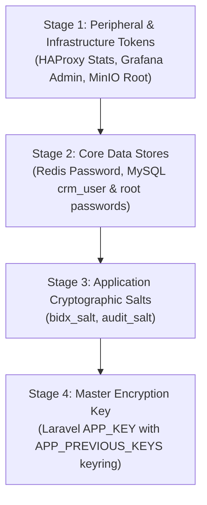

# NHMP 130 Helpline — Credential and Key Rotation Plan

**Document ID:** `NHMP-130-SEC-ROT-2026-V1`  
**Classification:** Operational Security Runbook / Key Lifecycle Specification  
**Standard Reference:** NIST SP 800-57 Part 1 Rev. 5 (Recommendation for Key Management), NIST SP 800-53 Rev. 5 (SC-12)  
**Effective Date:** November 2026  

---

## 1. Dependency-Aware Rotation Sequence

Credentials must never be rotated simultaneously across the cluster. Rotating credentials out of sequence will trigger cascading outages, authentication loops, or unrecoverable ciphertext errors. 

The rotation plan enforces a strict 4-stage dependency lifecycle:



---

## 2. Step-by-Step Rotation Procedures

### 2.1 Database Credentials Rotation (`crm_user` & `root`)
1. **Frequency:** Every 90 Days or immediately following suspected developer workstation compromise.
2. **Procedure:**
   - Generate high-entropy 32-character secret: `openssl rand -base64 24 > docker/secrets/db_password_new.txt`.
   - In MySQL Primary (`db-1`), create dual-password capability:
     ```sql
     ALTER USER 'crm_user'@'%' IDENTIFIED BY 'NEW_PASSWORD' RETAIN CURRENT PASSWORD;
     ```
   - Update `docker/secrets/db_password.txt` on host.
   - Perform rolling reload of application nodes (`app-1`, then `app-2`).
   - Verify application queries succeed via new credential.
   - Discard legacy password in MySQL:
     ```sql
     ALTER USER 'crm_user'@'%' DISCARD OLD PASSWORD;
     ```
   - Record sanitized audit log event.

### 2.2 Redis In-Memory Token Rotation (`redis_password`)
1. **Frequency:** Every 90 Days.
2. **Procedure:**
   - Generate new secret: `openssl rand -base64 24 > docker/secrets/redis_password_new.txt`.
   - In Redis container, set secondary authorized password dynamically:
     ```bash
     docker exec 130-redis-1 redis-cli -a "$CURRENT_PASS" CONFIG SET requirepass "$NEW_PASS"
     ```
   - Update `docker/secrets/redis_password.txt`.
   - Reload application containers.
   - Verify cache and queue workers reconnect without `NOAUTH` errors.

### 2.3 Laravel Master Key Rotation (`APP_KEY`)
1. **Risk:** Injudicious rotation of `APP_KEY` renders existing encrypted cookies, sessions, and legacy database fields unreadable.
2. **Keyring Architecture:**
   - In [config/app.php:L108-112](file:///home/mrpirzado/projects/130/config/app.php#L108-L112), the application maintains `'previous_keys'`:
     ```php
     'previous_keys' => [
         ...array_filter(explode(',', (string) env('APP_PREVIOUS_KEYS', ''))),
     ],
     ```
3. **Controlled Rotation Procedure:**
   - Generate new 256-bit key: `php artisan key:generate --show`.
   - Store current active key into `APP_PREVIOUS_KEYS` in `/run/secrets/app_previous_keys` or `.env`.
   - Set the newly generated key as active `APP_KEY` in `docker/secrets/app_key.txt`.
   - Execute the backward-compatible batch re-encryption command:
     ```bash
     php artisan crypto:migrate-gcm --batch=200
     ```
   - Confirm all 735,000+ records decrypt successfully and re-encrypt under the new key.
   - Once migration is 100% verified, deprecate and retire `APP_PREVIOUS_KEYS`.

---

## 3. Human User Password Rotation (Argon2id & NIST SP 800-63B)

1. **Algorithm:** Argon2id with memory cost `65536 KiB`, time cost `4`, parallelism `1` (tuned to complete in ~120ms on production cores).
2. **Policy:**
   - Expiration: 15-day mandatory rotation for operational personnel (`auth.password_expiry_days = 15`).
   - History: Retain last 5 hashes in `password_histories` table; prevent password reuse.
   - No Reversible Storage: Human passwords are never encrypted; one-way Argon2id hashes only.
   - Brute-Force Rate Limiting: Password rotation endpoint (`password.expired.update`) throttled to 5 attempts per minute per IP.
