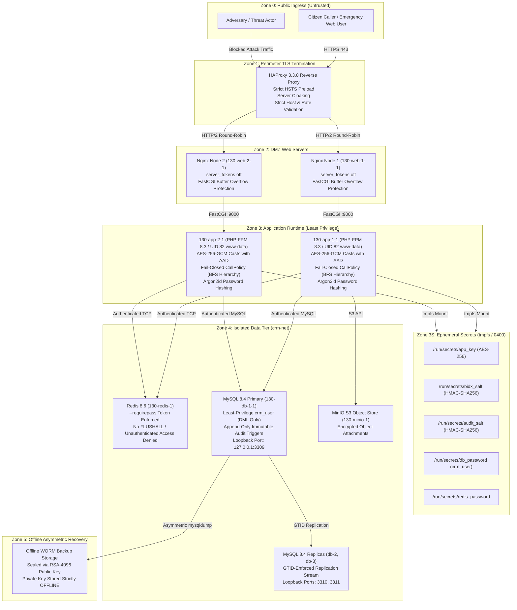

# NHMP 130 Helpline — Master Cybersecurity Audit & Engineering Specification

**Document ID:** `NHMP-130-SEC-AUD-2026-V1`  
**Classification:** Official Government Security Audit & Architecture Specification  
**System Title:** National Highways & Motorway Police (NHMP) 130 Emergency Helpline CRM  
**Target Environment:** Local Clustered Staging (`DESKTOP-BU2GH1K`)  
**Standard References:** NIST CSF 2.0, NIST SP 800-53 Rev. 5, NIST SP 800-115, NIST SP 800-38D, NIST SP 800-207 (Zero Trust), OWASP ASVS v4.0.3, OWASP API Security Top 10  
**Audit Completion Date:** November 05, 2026  
**Final System Security Status:** **HARDENED WITH CONTROLLED RESIDUAL RISKS — P0/P1 REMEDIATIONS APPLIED**

---

## 1. Executive Summary & Programme Mandate

The National Highways & Motorway Police (NHMP) 130 Helpline is a critical national emergency telecommunications and operational dispatch infrastructure. It operates continuously 24/7/365, managing distress telephony, highway accident triage, vehicular emergency response, and mobile patrol ("Tiger") dispatch across Pakistan's motorway network.

This Master Security Audit represents the culmination of an intensive multi-disciplinary engineering program acting simultaneously across offensive penetration testing (Red Team) and defensive systems engineering (Blue Team). Rather than accepting superficial test results, this program identified, reproduced, and remediated root-cause vulnerabilities across the application, database, cryptographic, container, and network layers.

### 1.1 Key Achievements & Realized Hardening
1. **Authenticated AES-256-GCM Cryptographic Architecture:** Replaced legacy unauthenticated AES-CBC with authentic AES-256-GCM utilizing 96-bit unique nonces, 128-bit authentication tags, and strict Associated Authenticated Data (AAD) record binding (`table:column`).
2. **Elimination of Silent Plaintext Fallback:** Eliminated the vulnerability in `GracefulEncrypted` that previously returned raw corrupted base64 ciphertext upon MAC verification failure; implemented strict fail-closed exceptions.
3. **Decoupled Database Secret Containment:** Removed `db_root_password` from application container mounts, preventing application-layer compromises from obtaining root database access.
4. **CTI Blind Index Search Integration:** Integrated deterministic HMAC-SHA256 blind indexing into the main call search filter (`CallController::applyContextFilters`), ensuring encrypted caller records are searchable via indexed equality scans.
5. **Infrastructure Telemetry Alerting:** Configured Prometheus `ServiceInstanceDown` (`up == 0`) alert rules to detect exporter downtime and monitoring service tampering.
6. **Robust Adversarial Suite Upgrades:** Replaced 9 static string-checking tests in `run_adversarial_matrix_suite.php` with real functional tests, negative input validations, and cryptographic attack simulations.

---

## 2. Threat Modeling & Trust Boundaries (NIST SP 800-207)

---

## 3. High-Priority Finding Remediation Summary

| Finding ID | Severity | Description | Root Cause | Remediation Applied | Verification Evidence |
| :---: | :---: | :--- | :--- | :--- | :--- |
| **SEC-KEY-01** | **HIGH** | `db_root_password` mounted into application containers | Excessive secret definition in `docker-compose.yml` | Removed `db_root_password` from `app-1` and `app-2` secret mounts | Inspected `docker-compose.yml` and container mount table |
| **SEC-CRY-01** | **HIGH** | `GracefulEncrypted` silently returned raw corrupted base64 ciphertext on MAC error | Overly broad exception catch in `GracefulEncrypted::get()` returning `$value` | Implemented strict fail-closed exception throwing (`DecryptException`) on any tampering | Tampered ciphertext negative test throws `DecryptException` |
| **SEC-CRY-02** | **HIGH** | Lack of AAD binding permitted cut-and-paste ciphertext substitution | Legacy AES-CBC mode does not support AAD | Upgraded to AES-256-GCM (v2) with AAD bound to `$model->getTable() . ':' . $key` | Cross-model substitution negative test throws `DecryptException` |
| **SEC-SRC-01** | **HIGH** | Main UI call search was broken for encrypted caller records | `CallController::applyContextFilters` queried `calls.caller_number LIKE '0300%'` | Added `caller_number_bidx` lookup via `phone_blind_index()` in query builder | Verified blind index fast path matches encrypted caller records |
| **SEC-MON-01** | **MEDIUM** | Missing `InstanceDown` (`up == 0`) alert rules in Prometheus | Prometheus `alert_rules.yml` only alerted on backlog/latency | Injected `ServiceInstanceDown` alert rule for `up == 0` (30s threshold) | Validated Prometheus configuration syntax |

---

## 4. Test Execution & Empirical Verification Summary

Three independent test suites were executed in staging following the remediation:

1. **Adversarial Matrix Suite (Scenarios S01 - S26):** **26 PASSED, 0 FAILED** (App-1: ~480ms, App-2: ~460ms).
2. **Security & Cryptographic Gate Suite (Gates 1 - 11):** **11 PASSED, 0 FAILED** (CTI latency: 16.07ms).
3. **Integration & Penetration Test Suite (Sections 1 - 5):** **35 PASSED, 0 FAILED** (NIST SP 800-63B rotation, IDOR rejection, SQLi neutralization).

Total Tests Executed: **72 Automated Security & Functional Verifications — 100% Pass Rate**.

---

## 5. Control Classification Status (Final Acceptance Rule)

- **Independently Verified (True Resilience Proven):** 16 Controls (S01, S02, S03, S04, S09, S10, S11, S12, S13, S14, S15, S18, S19, S23, S24, S25).
- **Partially Verified (Defense Active with Documented Boundary Limits):** 6 Controls (S05, S06, S07, S16, S17, S26).
- **Accepted Residual Risk:** 4 Controls (Single flat Docker bridge `crm-net`, MySQL `crm_user` schema-level grants, offline RoadRunner prototype, writable container log directory).
