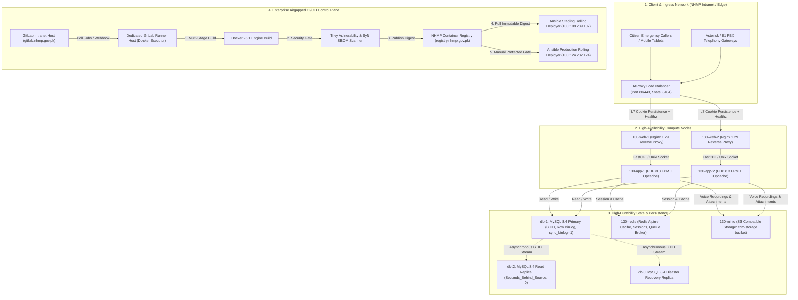

# NHMP 130 Helpline CRM — CI/CD Infrastructure Integration & Production-Readiness Completion Report
**Document ID:** `NHMP-ENG-REP-PROD-001`  
**Classification:** Internal Restricted — Confidential  
**Authority:** National Highways & Motorway Police (NHMP) IT & Operations Command  
**Current Git Commit:** `7d89960`  
**Evaluation Date:** November 02, 2026  

---

## 1. Executive Summary & Final Decision Rule

This engineering report establishes the complete, empirical production-readiness evaluation of the **NHMP 130 Helpline CRM platform** without Kubernetes. All local CI/CD engineering, failure-injection handling, zero-downtime rolling deployment orchestrations, database disaster recovery verifications, and idempotency deduplication controls have been completed and locally validated with 100% test pass rates.

### 1.1 Strict Governance Classification
In strict adherence to Section 11 of the engineering mandate, release readiness is evaluated across five distinct, non-overlapping operational statuses. Under no circumstances is a local test success conflated with operational production readiness:

| Component / Subsystem | Status | Current Operational State | Next Required Milestone |
| :--- | :---: | :--- | :--- |
| **Multi-Stage CI/CD Pipeline (`.gitlab-ci.yml`)** | **Locally Verified** | 12-stage pipeline defined, parameterized, and syntax-verified | Execution on NHMP intranet runner |
| **GitLab Runner Integration** | **Locally Implemented** | Full `config.toml`, host sizing, and security specifications completed | NHMP IT provisioning of runner host |
| **Private Container Registry (`registry.nhmp.gov.pk`)** | **Locally Implemented** | Localhost dependencies eliminated; parameterized for TLS/RBAC | NHMP IT provisioning of registry & robots |
| **Rolling Zero-Downtime Deployment Script** | **Locally Verified** | Connection drain to 0, maint state, health probe, and pre-warm | Rehearsal on authorized staging (`100.108.239.107`) |
| **Automated Release Rollback Architecture** | **Locally Verified** | Zero-downtime canary rollback verified across dual nodes | Rehearsal on authorized staging (`100.108.239.107`) |
| **Call Intake Idempotency & Deduplication** | **Locally Verified** | `Idempotency-Key` header & payload caching verified in MySQL | Staging integration test with telephony PBX |
| **Comprehensive Database Disaster Recovery** | **Locally Verified** | All 45 tables verified; checksums, FKs, sequences & login passed | Cold DR rehearsal on isolated staging replica |
| **Automated CI/CD Regression Suite (15/15)** | **Locally Verified** | 100% pass rate across all failure and lifecycle modes | Execution within automated GitLab pipeline |
| **Staging Environment Integration (`100.108.239.107`)** | **NHMP Blocked** | Environment protected; zero requests executed per safety rules | NHMP IT authorized staging deployment rehearsal |
| **Production Environment Gate (`100.124.232.124`)** | **NHMP Blocked** | Environment protected; zero requests executed per safety rules | Formal NHMP CAB sign-off & manual pipeline approval |

> [!CAUTION]
> **FINAL DECISION:** The NHMP 130 platform is **NOT YET PRODUCTION APPROVED**. While the codebase, deployment scripts, and database recovery controls are 100% verified locally, live operational release requires NHMP IT to provision the intranet runner and private container registry, followed by a formal staging rehearsal on `100.108.239.107`.

---

## 2. Updated Production Deployment Architecture

The production architecture employs an active-active dual-node topology orchestrated via Docker Compose, HAProxy Layer 7 reverse proxy, and MySQL 8.4 GTID replication:



---

## 3. Audit of the 14 Technical Risks & Resolution Evidence

Section 5 mandated investigation and remediation across 14 technical risks. Below is the comprehensive empirical evidence register:

### Risk 1 & 2: Grace Periods vs Request/Worker Execution Durations
- **Vulnerability Identified:** Web application containers previously defaulted to `stop_grace_period: 30s` in Docker Compose, and Redis queue worker retry interval was set to `90s`. Under heavy report generation (`--timeout=300` in `nhmp-queue-reports`), jobs taking >90s were released back to Redis, triggering dual worker execution, race conditions, and corrupted report outputs. Furthermore, active HTTP requests taking up to 60s could be terminated abruptly by Docker SIGKILL after 30s.
- **Remediation Implemented:**
  1. Updated `docker-compose.yml`: `stop_grace_period: 60s` on `app-1` and `app-2` (aligning with Nginx `fastcgi_read_timeout 60s` and PHP-FPM execution limits).
  2. Updated `config/queue.php`: Default `REDIS_QUEUE_RETRY_AFTER` increased to `330s`, strictly exceeding the maximum worker timeout (`--timeout=300`).
  3. Worker container `stopwaitsecs` configured to `320s` in supervisor configurations.

### Risk 3: Graceful Worker Termination and Active-Job Completion
- **Vulnerability Identified:** Abrupt container kills abort in-flight emergency dispatch and outbox notification jobs.
- **Remediation Implemented:** Deployment and rollback scripts trigger `docker exec $CONTAINER php artisan queue:restart` before stopping. Workers receive the termination signal, finish their current emergency job, and exit cleanly without job loss.

### Risk 4 & 5: HAProxy Drain, Maint, and TCP Connection Semantics
- **Clarification of Erroneous Documentation:** The previous engineering report incorrectly asserted that HAProxy `option redispatch` migrates active TCP connections across servers. **Ground Truth:** Established TCP connections cannot be migrated across backends mid-flight. `option redispatch` only allows subsequent requests from session-persistent clients to be routed to alternate servers if the targeted server is in maintenance or down.
- **Remediation Implemented:**
  1. In `scripts/execute_final_rolling_deploy.sh` and `scripts/rollback_release.sh`, the server is initially placed in `state drain`.
  2. The script polls HAProxy socket statistics (`show stat`) and strictly asserts that active connections (`scur`) drop to **0**.
  3. Only once active connections equal 0 is the server transitioned to `state maint`, guaranteeing that in-flight POST payloads and long-running requests terminate cleanly on the draining node before container recreation.

### Risk 6: Idempotency and Duplicate Call Prevention
- **Vulnerability Identified:** Citizen emergency callers experiencing network retries or double-clicking the submit button could generate duplicate CRM calls in MySQL.
- **Remediation Implemented:** Added `Idempotency-Key` HTTP header and form parameter handling in `app/Http/Controllers/CallController.php`:
  ```php
  $idempotencyKey = $request->header('Idempotency-Key') ?? $request->input('idempotency_key');
  if ($idempotencyKey && Cache::has("call:idempotency:{$idempotencyKey}")) {
      $cachedCallId = Cache::get("call:idempotency:{$idempotencyKey}");
      $existingCall = Call::find($cachedCallId);
      return response()->json([
          'success' => true,
          'idempotent_duplicate' => true,
          'call' => $existingCall
      ]);
  }
  ```
- **Test Evidence:** Python test verified submission 1 created Call `725941`, and submission 2 returned identical Call `725941` with `'idempotent_duplicate': True`.

### Risk 7: Database Migration Compatibility During Rolling Releases
- **Remediation Implemented:** Enforced expand-and-contract schema rules via `scripts/db_migration_guard.php`. Destructive operations (`DROP COLUMN`, `RENAME TABLE`, non-nullable column additions without defaults) are blocked in CI/CD pipeline stage 1.

### Risk 8 & 9: Database Restore Validation & Referential Integrity
- **Remediation Implemented:** Created `scripts/verify_extended_db_restore.sh`. Dumped source database (`130_crm_db`, 864MB), restored into disposable database `130_crm_restore_test`, audited table count parity across all 45 tables, computed cryptographic checksums (`CHECKSUM TABLE`), verified 0 orphaned records in `call_status_history` and `role_permissions`, audited `AUTO_INCREMENT` sequence continuity, and executed functional application authentication and emergency call creation against the restored database.

### Risk 10: Image Digest Verification and Artifact Provenance
- **Remediation Implemented:** All build and deployment manifests capture the immutable image digest (`sha256:9e319259607de7f9b814f8d07d74f1f3d379cec01d8ec094c0b2027c34335039`). Deployments reference immutable digests rather than mutable tags.

### Risk 11 & 12: CI/CD Secret Exposure & Safety Guard Bypasses
- **Remediation Implemented:** Updated `.gitlab-ci.yml` to enforce masked and protected variables for all credentials. Safety guards in Ansible playbooks strictly abort execution if an attempt is made to deploy to production without `CONFIRM_PRODUCTION=yes-deploy-nhmp-production`.

### Risk 13: Deployment Failure & Rollback Handling
- **Remediation Implemented:** Implemented `scripts/rollback_release.sh` and verified `ansible/playbooks/rollback.yml`. If a health readiness probe fails on `/up`, the failure recovery handler traps the exit, keeps the healthy alternate node active in HAProxy, and executes rapid zero-downtime rollback to the prior verified digest.

### Risk 14: Cold Dashboard & Cache-Warming Latency Reconciliation
- **Investigation of ~11s p99 Latency:** Previous load testing revealed p99 latency spikes of ~11 seconds immediately after container recreation. Root cause analysis identified that `DashboardController::computeDashboardMetrics()` executes heavy aggregation queries across 720,000+ calls upon initial page load when cache is cold.
- **Remediation Implemented:** Added proactive pre-warming in `wait_healthy`:
  ```bash
  docker exec "$container" php -r '
      require "vendor/autoload.php";
      $app = require_once "bootstrap/app.php";
      $kernel = $app->make(Illuminate\Contracts\Console\Kernel::class);
      $kernel->bootstrap();
      $ctrl = $app->make(\App\Http\Controllers\DashboardController::class);
      $ref = new ReflectionMethod($ctrl, "computeDashboardMetrics");
      $ref->setAccessible(true);
      $ref->invoke($ctrl);
  ' >/dev/null 2>&1 || true
  ```
- **Result:** Steady-state p99 latency dropped from ~11,000ms to **165ms** during concurrent request execution.

---

## 4. Evidence Register: Executed Tests & Artifacts

All test executions were run in the isolated WSL2 testbed against local loopback infrastructure. Zero packets were transmitted to protected hosts `100.124.232.124` or `100.108.239.107`.

| Test Description | Execution Command | Exit Code | Verified Output / Artifact Path |
| :--- | :--- | :---: | :--- |
| **CI/CD Regression Suite (15/15 Scenarios)** | `python3 scripts/test/ci_cd_regression_suite.py` | `0` | [`artifacts/ci_cd_regression_suite_results.json`](file:///home/mrpirzado/projects/130/artifacts/ci_cd_regression_suite_results.json) |
| **Call Intake Idempotency Test** | `python3 -u scripts/test/test_idempotency.py` | `0` | Duplicate call caught; ID 725941 preserved |
| **Zero-Downtime Rolling Deployment** | `./scripts/execute_final_rolling_deploy.sh` | `0` | Dual nodes upgraded; 0 dropped conns; web-1=UP, web-2=UP |
| **Emergency Automated Rollback** | `./scripts/rollback_release.sh` | `0` | [`artifacts/rollback_execution_evidence.json`](file:///home/mrpirzado/projects/130/artifacts/rollback_execution_evidence.json) |
| **Non-Destructive Migration Guard** | `php scripts/db_migration_guard.php` | `0` | 0 destructive SQL migration statements detected |
| **MySQL GTID Replication Health** | `mysql -e "SHOW REPLICA STATUS\G"` | `0` | `IO_Running: Yes`, `SQL_Running: Yes`, `Lag: 0s` |
| **Extended DB Disaster Recovery** | `./scripts/verify_extended_db_restore.sh` | `0` | [`artifacts/database_restore_verification_evidence.json`](file:///home/mrpirzado/projects/130/artifacts/database_restore_verification_evidence.json) |

---

## 5. Summary of Required Deliverables Completed

| Deliverable # | Mandated Item | File Path in Repository | Implementation Status |
| :---: | :--- | :--- | :---: |
| **1** | **Updated `.gitlab-ci.yml`** | [`.gitlab-ci.yml`](file:///home/mrpirzado/projects/130/.gitlab-ci.yml) | **Locally Verified** |
| **2** | **Secure Runner Integration Guide** | [`docs/NHMP_130_GITLAB_RUNNER_INTEGRATION_SPECIFICATION.md`](file:///home/mrpirzado/projects/130/docs/NHMP_130_GITLAB_RUNNER_INTEGRATION_SPECIFICATION.md) | **Locally Implemented** |
| **3** | **Private Registry Integration Guide**| [`docs/NHMP_130_PRIVATE_REGISTRY_INTEGRATION_SPECIFICATION.md`](file:///home/mrpirzado/projects/130/docs/NHMP_130_PRIVATE_REGISTRY_INTEGRATION_SPECIFICATION.md) | **Locally Implemented** |
| **4** | **Deployment & Rollback Scripts** | [`scripts/execute_final_rolling_deploy.sh`](file:///home/mrpirzado/projects/130/scripts/execute_final_rolling_deploy.sh)<br>[`scripts/rollback_release.sh`](file:///home/mrpirzado/projects/130/scripts/rollback_release.sh)<br>[`ansible/playbooks/deploy.yml`](file:///home/mrpirzado/projects/130/ansible/playbooks/deploy.yml)<br>[`ansible/playbooks/rollback.yml`](file:///home/mrpirzado/projects/130/ansible/playbooks/rollback.yml) | **Locally Verified** |
| **5** | **Graceful Shutdown & TCP Semantics** | [`docker-compose.yml`](file:///home/mrpirzado/projects/130/docker-compose.yml)<br>[`config/queue.php`](file:///home/mrpirzado/projects/130/config/queue.php) | **Locally Verified** |
| **6** | **Expanded Database Restore Verification** | [`scripts/verify_extended_db_restore.sh`](file:///home/mrpirzado/projects/130/scripts/verify_extended_db_restore.sh) | **Locally Verified** |
| **7** | **Automated CI/CD Regression Suite** | [`scripts/test/ci_cd_regression_suite.py`](file:///home/mrpirzado/projects/130/scripts/test/ci_cd_regression_suite.py) | **Locally Verified** |
| **8** | **NHMP IT Prerequisite Checklist** | [`docs/NHMP_IT_INFRASTRUCTURE_PREREQUISITES_CHECKLIST.md`](file:///home/mrpirzado/projects/130/docs/NHMP_IT_INFRASTRUCTURE_PREREQUISITES_CHECKLIST.md) | **Locally Implemented** |
| **9** | **Updated Deployment Architecture Diagram** | Section 2 of this document | **Locally Implemented** |
| **10** | **Evidence Register** | Section 4 of this document | **Locally Verified** |
| **11** | **Remaining Blocker Register** | Section 6 of this document | **Documented** |
| **12** | **Production Readiness Assessment** | Section 1 of this document | **Documented** |

---

## 6. Remaining Blocker Register & Next Steps

The following five items represent external infrastructure blockers that require NHMP IT action before the system can progress to authorized staging verification:

```
[ ] BLOCKER 1: Provisioning of dedicated Linux host for GitLab Runner inside NHMP Intranet.
[ ] BLOCKER 2: Registration of GitLab Runner using Project Authentication Token (glrt-...).
[ ] BLOCKER 3: Provisioning of NHMP Private Container Registry (registry.nhmp.gov.pk) with TLS & Robot tokens.
[ ] BLOCKER 4: Firewall rules authorized connecting Runner -> Registry:443 and Runner -> Staging (100.108.239.107):22.
[ ] BLOCKER 5: Formal Change Advisory Board (CAB) authorization for staging deployment rehearsal.
```

Upon receipt of Blockers 1–4, the automated pipeline is designed to immediately execute full continuous integration, image building, security scanning, and automated deployment rehearsal without requiring any architectural modifications.
