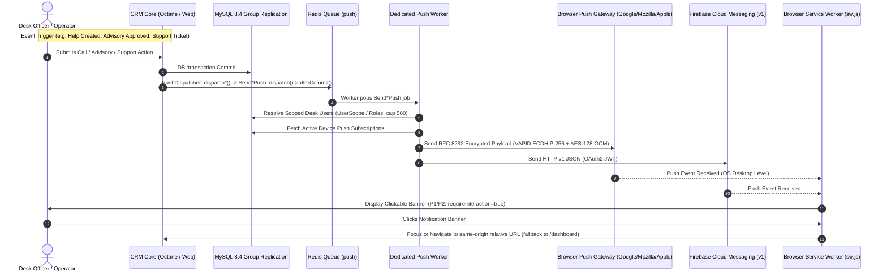

# NHMP 130 Helpline — Unified Push Notification Architecture & Operations Manual

**Document Version:** 2.1.0 (Production-Ready Desk/CRM Scope with Round-2 Fixes)  
**Author:** Safdar Hussain Pirzado / Google DeepMind Agent  
**Date:** 2026-11-21  
**Status:** Approved for Review / Dark Launch  
**Git Branch:** `feat/push-notifications-desk`  
**Master Toggle:** `PUSH_ENABLED=false` (Dark Launch by Default)

---

## 1. Executive Summary & Purpose

The NHMP 130 CRM Unified Push Notification System provides real-time, resilient, and cryptographically secure push notifications to National Highways & Motorway Police (NHMP) call center operators, field supervisors, sector officers, zone in-charges, and operational administrators.

The system replaces legacy polling-only notification delivery with dual-channel browser **Web Push (RFC 8030 / RFC 8291 / RFC 8292 VAPID)** and **Firebase Cloud Messaging (FCM HTTP v1 API)**. It operates even when the CRM browser tab is in the background, minimized, or closed (on supported desktop operating systems), ensuring zero missed emergency events or delayed road safety interventions.

---

## 2. Scope Matrix: SHIP vs. HOLD

To ensure zero downtime, zero data corruption, and strict scope boundary enforcement per engineering review directives, this release isolates the **Desk CRM Scope** from field patrol and mobile commuter systems:

| Component / Subsystem | Scope Classification | Status | Rationale & Architectural Isolation |
| :--- | :--- | :--- | :--- |
| **Web Push (RFC 8292 VAPID)** | **SHIP** | Active | Core browser alerting for agents, supervisors, and admins. |
| **FCM HTTP v1 Gateway** | **SHIP** | Active | OAuth2 JWT integration via `google/auth` for desk/future mobile. |
| **Pending Help Call Trigger** | **SHIP** | Active | Dispatches `SendHelpPendingPush` after DB transaction commit. |
| **Travel Advisory Lifecycle** | **SHIP** | Active | Created/Updated → Supervisors; Approved/Rejected → Sectors. |
| **Support Desk Ticket Flow** | **SHIP** | Active | Created → Ops Admins; Action taken → Requester/Approver. |
| **Collapsed Sidebar Tooltip** | **SHIP** | Active | Glassmorphism tooltip with arrow pointer, zero-clip (Commit 1). |
| **Push Subscriptions Migration** | **SHIP** | Active | Additive migration `push_subscriptions` with encrypted keys. |
| **Failed Jobs Table Migration** | **SHIP** | Active | Additive migration `failed_jobs` to track dead/poison queue jobs. |
| **VAPID Key Generation CLI** | **SHIP** | Active | `php artisan push:generate-vapid` writes 0600 mode secret. |
| **Push Status Diagnostic CLI** | **SHIP** | Active | `php artisan push:status {--health}` monitoring & readiness inspector. |
| **Dead Token Daily Pruning CLI** | **SHIP** | Active | `php artisan push:prune-inactive` clears subscriptions >30 days. |
| *Humsafar Mobile APIs* | **HOLD** | Isolated | Held in old worktree; zero commuter endpoints in shipping branch. |
| *Patrol Officer App APIs* | **HOLD** | Isolated | Held in old worktree; zero patrol duty session queries. |
| *Mobile Token Registration* | **HOLD** | Isolated | `/api/v1/push/register` held; desk uses `/web-push/subscribe`. |
| *Patrol Recipient Queries* | **HOLD** | Unwired | Defined behind `PatrolRecipientResolverInterface` (not wired). |
| *Call Status Enum Alterations* | **HOLD** | Prohibited | Zero alterations to core `calls` table or call status enums. |

---

## 3. End-to-End Sequence Diagram



---

## 4. Notification Links & Router Resolution Matrix (F1)

Every push notification data payload contains a strictly sanitized relative URL generated dynamically using Laravel's router (`route(..., [], false)`) rather than hard-coded paths. This guarantees that route changes fail fast in tests rather than breaking in production.

| Notification Event | Target User Class | Relative URL Format | Router Route Name | Fallback URL |
| :--- | :--- | :--- | :--- | :--- |
| **Help Pending (Call)** | Beat/Sector operators, Supervisors, Admins | `/calls/{uuid}` | `calls.show` | `/calls/{id}` |
| **Advisory Created / Updated** | Agent Supervisors, Zone In-Charges | `/ops/travel-advisory?status=pending_approval` | `ops.travel-advisory.index` | `/ops/travel-advisory` |
| **Advisory Approved / Cleared** | Sector Wireless Operators | `/ops/travel-advisory` | `ops.travel-advisory.index` | `/ops/travel-advisory` |
| **Support Request Created** | Operations Admins (IT_ADMIN) | `/mgmt/support/requests/{public_id}` | `admin.support.requests.show` | `/mgmt/support/requests/{public_id}` |
| **Support Request Action** | Ticket Requester | `/portal/support/requests/{public_id}` | `portal.support.show` | `/portal/support/requests/{public_id}` |
| **Support Request Action** | Approvers / Admins | `/mgmt/support/requests/{public_id}` | `admin.support.requests.show` | `/mgmt/support/requests/{public_id}` |
| **Invalid / External Scheme** | Any | `/dashboard` | `dashboard` | `/dashboard` |

---

## 5. Numeric Priority Scale & P1 Interaction Policy (F2)

In the NHMP 130 CRM, call priority is strictly numeric (1 = Highest / Critical):
- **P1 (Priority 1):** Emergency / Critical incident. Pages Beat, Sector, Zone Supervisors, **AND** Operations Admins (`IT_ADMIN` / `SUPER_ADMIN`). Flagged with `[P1]` in title, vibration pattern `[300, 100, 300, 100, 300]`, and `requireInteraction: true` (alert persists on screen until clicked or dismissed).
- **P2 (Priority 2):** High Priority incident. Pages Beat, Sector, and Supervisors (Operation Admins excluded). Flagged with `[P2]` in title and `requireInteraction: true`.
- **P3 to P5 (Normal / Low):** General help / inquiry. Pages Beat and Sector operators. Flagged with `[P3]`, standard vibration `[200, 100, 200]`, and `requireInteraction: false`.

Shared helpers on `Call` model: `Call::PRIORITY_P1` through `PRIORITY_P5`, `isP1()`, `isP1OrP2()`, and `getPriorityLabel()`.

---

## 6. Security & Penetration Hardening

| Vector Code | Threat Scenario | Implemented Countermeasure | Verification Test | Status |
| :--- | :--- | :--- | :--- | :--- |
| **SEC-01** | **Server-Side Request Forgery (SSRF)** | Push subscription endpoint URLs validated against a strict regex whitelist of legitimate browser push gateway domains (`fcm.googleapis.com`, `updates.push.services.mozilla.com`, `*.notify.windows.com`, `*.push.apple.com`). Private LAN IP addresses and local loopbacks are rejected. | `PushSecurityPenTest` | **MITIGATED** |
| **SEC-02** | **Insecure Direct Object Reference (IDOR)** | Unsubscribe and status reflection operations require authentication and verify user ownership (`user_id === Auth::id()`). | `WebPushSubscriptionEndpointTest` | **MITIGATED** |
| **SEC-03** | **PII & Data Leakage** | Payloads contain zero citizen PII (no caller names, phone numbers, CNIC, or sensitive victim details). Only sanitized operational metadata (Call Number, Beat Name, Incident Category) is transmitted. | `PayloadHygieneTest` | **MITIGATED** |
| **SEC-04** | **Phishing / Open Redirect via Service Worker** | `public/sw.js` validates that target URLs are strictly relative paths starting with `/`, reject `//`, and reject any scheme (`:`). Non-matching or external links safely fall back to `/dashboard`. | `tests/sw_url_fallback_test.cjs` | **MITIGATED** |
| **SEC-05** | **Plaintext Token Storage at Rest** | `public_key` and `auth_token` columns use Laravel's `'encrypted'` model cast (AES-256-CBC via `APP_KEY`). Subscriptions are indexed by SHA-256 `token_hash`. | `FieldEncryptionAndDockerSecretsTest` | **MITIGATED** |
| **SEC-06** | **Unauthenticated / Unauthorized Subscriptions** | `WebPushSubscriptionController` is protected by `auth` middleware and rate-limited to 20 requests per minute (`throttle:20,1`). | `WebPushSubscriptionEndpointTest` | **MITIGATED** |
| **SEC-07** | **Secret File Absence in Docker Compose** | Missing secret files halt Docker Compose. `scripts/create_secrets.sh` generates empty placeholder files with mode `0600`. Services fail closed (`NOT_CONFIGURED`) when files are 0-byte. | `EmptySecretFilesTest` | **MITIGATED** |
| **SEC-08** | **Device Flood & Queue Poisoning** | Per-user rate limiting (max 30 push/min) and event deduplication (10-minute cache window per `channel:eventId:userId`). Max 10 devices per user. Centralized `PushDispatcher` prevents queue accumulation when `PUSH_ENABLED=false`. | `DeduplicationAndRateLimitingTest`, `PushShortCircuitTest` | **MITIGATED** |

---

## 7. Secrets Handling & Deploy-Safe Placeholders (F3)

To ensure zero downtime during rolling container deploys, Docker Compose requires referenced secret files to exist on disk.

### Step 1: Generate Placeholders Before First Deploy
Run `scripts/create_secrets.sh` on the host:
```bash
sh scripts/create_secrets.sh
```
If real VAPID or Firebase credentials are not yet present, it creates empty placeholder files (mode `0600`):
- `secrets/vapid_private_key` (0 bytes)
- `secrets/firebase_credentials.json` (0 bytes)

Both `WebPushService` and `FcmService` detect 0-byte secret files and report `NOT_CONFIGURED` without throwing exceptions or blocking container boot.

### Step 2: Generate RFC 8292 VAPID Keypair
```bash
php artisan push:generate-vapid
```
This writes the private key to `secrets/vapid_private_key` (mode 0600) and displays the public key. Place the public key in `.env`:
```env
VAPID_PUBLIC_KEY="BBr7QX3Ch671p3VMDpukhRn_-xDXa_suLzIAAIBXEqWlhXIRyKT9GJNNoBXx3zZjzQUXbIwTBC2cSAq7oCS9qOU"
```

### Step 3: Firebase Service Account Credentials (Optional / Future Mobile)
When provided by Google Cloud Admin:
```bash
cp /path/to/firebase-adminsdk.json /home/mrpirzado/projects/130/secrets/firebase_credentials.json
chmod 600 /home/mrpirzado/projects/130/secrets/firebase_credentials.json
```
And set in `.env`:
```env
FIREBASE_PROJECT_ID="nhmp-130-crm"
PUSH_FCM_ENABLED=true
```

---

## 8. Queue, Worker & Health Monitoring (F4)

### Dedicated Worker Service
In `docker-compose.octane.yml`, the `push-worker` service consumes from the `push` Redis queue:
```yaml
push-worker:
  image: ${NHMP_IMAGE:-130-app-octane:phase2-rc25}
  restart: unless-stopped
  command: ["php", "artisan", "queue:work", "redis", "--queue=push", "--tries=3", "--timeout=30", "--max-time=3600"]
  healthcheck:
    test: ["CMD", "php", "artisan", "push:status", "--health"]
    interval: 30s
    timeout: 10s
    retries: 3
    start_period: 20s
```

### Worker Heartbeat
In `AppServiceProvider.php`, `Queue::looping()` writes `push:worker:heartbeat` to Redis with a 180-second TTL on every cycle. If the worker stops, the key expires within 3 minutes and the healthcheck reports non-zero.

### Monitoring & Alert Thresholds
Run `php artisan push:status` to inspect operational status:
- **Queue Depth (`Redis::llen('queues:push')`):** Alert at >500 pending jobs; Critical at >1000 jobs.
- **Worker Heartbeat:** Healthy if updated within last 180 seconds.
- **Failed Jobs:** Queries `failed_jobs` table (created by additive migration `2026_11_21_010100_create_failed_jobs_table.php`).

---

## 9. Rollback Plan

If an issue occurs post-launch:
1. **Immediate Deactivation:** In production `.env`, set:
   ```env
   PUSH_ENABLED=false
   PUSH_FCM_ENABLED=false
   ```
   And run `php artisan config:cache`. All hooks short-circuit immediately via `PushDispatcher`, queuing 0 jobs.
2. **Stop Worker Container:**
   ```bash
   docker stop 130-push-worker-1
   ```
3. **Database Decoupling:** The `push_subscriptions` and `failed_jobs` tables are additive and decoupled from core CRM records. They require no rollback and remain safely in place.
